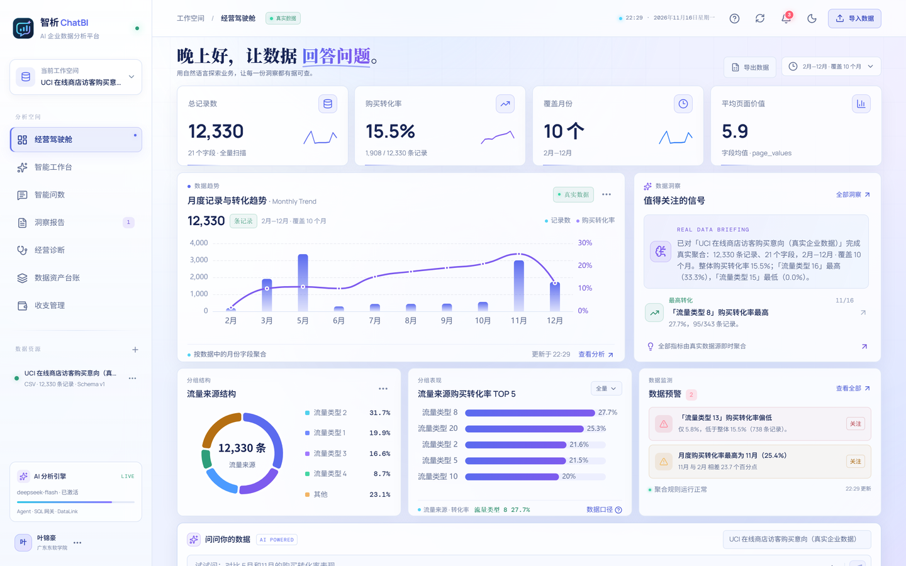
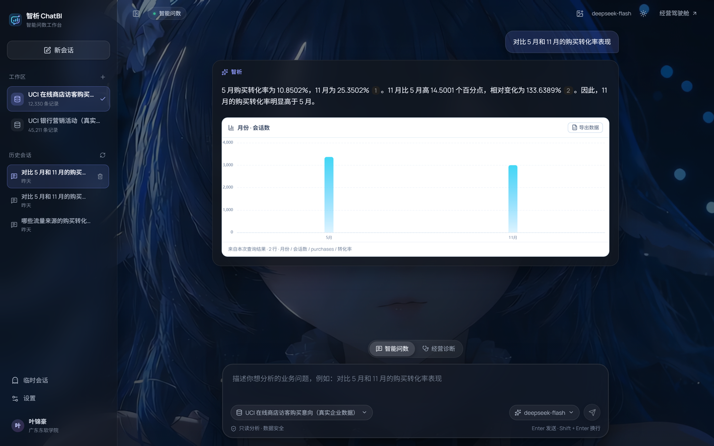
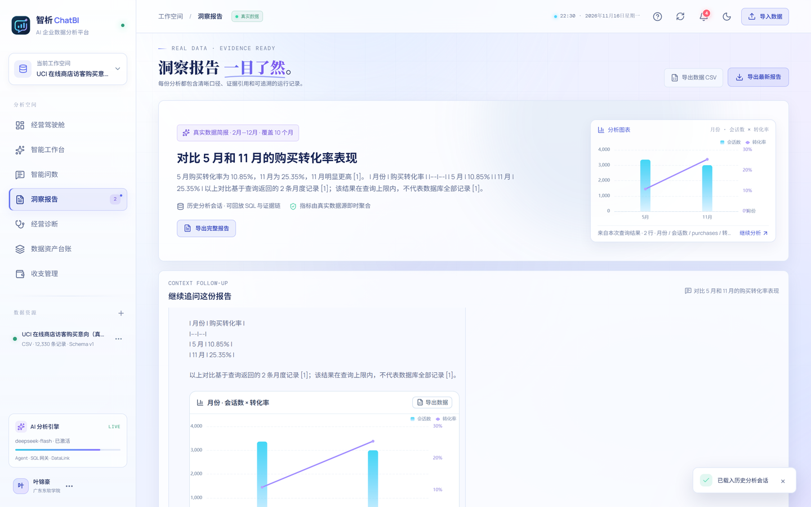
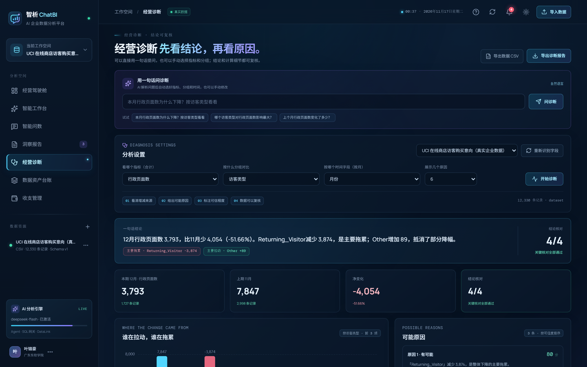
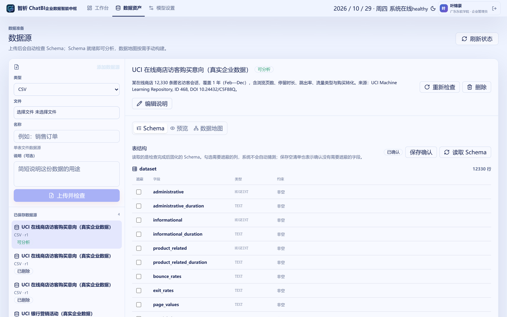
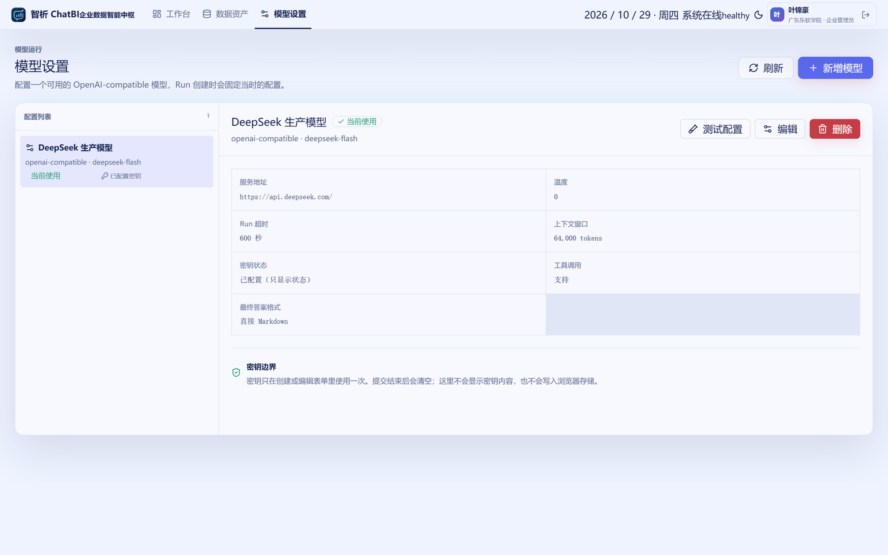
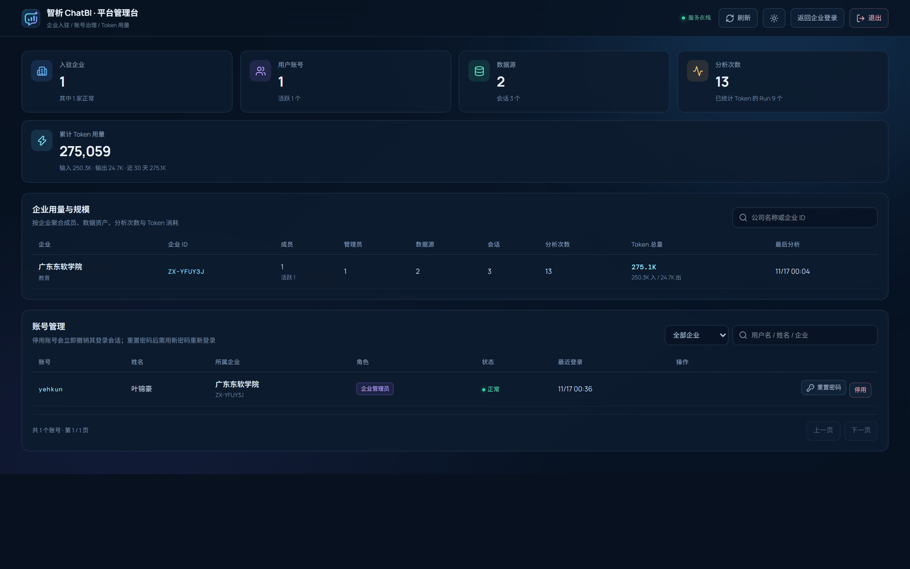

# 智析 ChatBI

> AI 对话式企业数据分析与可视化平台 · 第九届传智杯 AI WEB 网页开发挑战赛参赛作品 · Team YK

**在线演示：http://8.163.102.104:18080** — 已部署上线，评审期间保持可用。登录所需评审测试账号随提交包单独提供，不写入本仓库。

**代码仓库：https://github.com/YehKuN/zhixi-chatbi**

| 团队信息 | |
| --- | --- |
| 团队名称 / 编号 | Team YK / 43581（B 组） |
| 所属院校 | 广东东软学院 · 软件工程 |
| 参赛队员 | 叶锦豪、洪富凯 |
| 指导教师 | 黄淳笙 |

智析 ChatBI 让业务人员用一句中文问题完成“取数—分析—成图—解释”。平台把自然语言理解、受控分析 Agent、只读 SQL 网关、Python 沙箱和语义图谱组合成一条可审计、可回放、可验证的分析链路：模型负责理解与表达，运行时负责边界与证据，页面负责把结论、图表和依据放在同一个工作台里。

平台的两大核心能力是**智能问数**与**经营诊断**：前者回答“是多少、趋势如何”，后者回答“为什么变化、原因有多可信”。两者共用同一套指标语义、只读网关与证据链，但计算路径完全独立——问数走受控 Agent 工具调用，诊断走确定性算子流水线。




## 项目解决什么问题

企业经营分析其实包含两类问题：一类是“是多少、趋势如何”，另一类是“为什么变化、原因是什么”。传统 BI 把前者做成了“业务提需求 → 分析师排期 → 写 SQL → 配图表 → 解释口径”的长链路，周期长、门槛高；后者更依赖分析师个人经验，归因过程难以复现，结论也难以复核。大模型聊天工具能给出看似合理的解释，但经常无法证明数字来自哪里，更无法证明“原因”是否成立，也不敢接入企业真实库。

智析 ChatBI 的答案是：**对话式交互 + 受控执行 + 证据链**，并把能力拆成两条互补路径——智能问数负责“把数取对、把图画对”，经营诊断负责“把原因找对、把可信度说清”。

- 对话即查询：中文问题直接进入分析流程，不需要写 SQL、拖字段、配图表。
- 受控执行：模型只能调用 4 个白名单工具，SQL 只读、结果限流、脚本隔离。
- 诊断可执行：把“为什么下降”编译成类型化配方 DAG，由 5 个确定性算子计算，不靠模型自由发挥。
- 诊断可验证：贡献和=总变化、份额和=1 等 7 项不变量先过关，再输出置信区间、稳健性与辛普森检查；不达标标记 invalid / insufficient。
- 证据可查：问数与诊断共用同一条证据链，每个结论回指 SQL 审计、查询结果、`evidence_id`、Artifact 与引用材料。
- 演示可复现：没有模型 Key、没有企业数据时，仍可用 906 条合成订单完整演示。
- 真实可落地：支持 CSV / SQLite / MySQL，字段遮蔽确认后才能创建真实 Run。

## 两大核心能力

### 智能问数：一句话完成取数、成图与解释

智能问数把中文问题变成一次可审计的分析运行。模型负责理解问题、规划步骤和组织语言，真正的取数与计算由受控运行时完成；每个结论都能回指 SQL、结果集与产物。

```text
一句中文问题
   → 意图与计划（Session / Run，Pydantic 计划契约 + 归一化 + 定向修复）
   → 4 个白名单工具（run_sql_readonly / run_python / explore_datalink / commit_analysis_claims）
   → 证据链（SQL 审计号、结果集、Artifact、引用材料）
   → 流式回答 + 图表自动挂载 + CSV / 原图导出
```

| 环节 | 实现 |
| --- | --- |
| 模型边界 | 模型只做理解、规划与表达，不直接触库、不执行任意代码 |
| SQL 只读 | SQLGlot AST 校验、字段白名单、强制 LIMIT（默认 100 / 上限 500）、全量审计 |
| Python 沙箱 | Docker `--network none`、`--cpus 1`、`--memory 512m`、`--pids-limit 64`、`--cap-drop ALL`、只读根 |
| 失败处理 | 计划校验失败定向修复并限制重试；流式断线可续读；稳定错误码 |
| 证据追溯 | 结论回指 SQL、结果集、Artifact 与引用；工作台可回放 Trace DAG |
| 质量基线 | 20 题中文电商基准（0.05% 数值容差 + 单元格匹配）、178 条 Run 协议用例、Prompt A/B 实验 |

### 经营诊断：回答“为什么变化”

经营诊断面向“本月营收为什么下降”“各区域贡献如何”这类问题：系统把自然语言解析为结构化分析意图，再编译成可复现的分析配方，由确定性指标层与诊断算子完成计算，最终输出带证据、置信度和验证状态的结论与可视化。

```text
一句中文问题（如“本月营收为什么下降”）
   → 意图解析（指标 / 时间范围 / 对比基线 / 维度 / 筛选，歧义时最小化澄清）
   → 类型化配方 DAG（aggregate → compare → decompose → segment_scan → verify）
   → 5 个确定性算子 + 假设枚举
   → 7 项不变量 + 置信区间 + 稳健性 / 辛普森检查
   → 瀑布图 + 证据抽屉 + 结论 + CSV / 报告导出
```

| 能力 | 实现 |
| --- | --- |
| 指标语义 | metrics.yaml 注册 10 个指标、6 个维度与同义词；公式只允许 SUM / AVG / COUNT / COUNT_DISTINCT / MIN / MAX 与四则运算，不接受任意 SQL |
| 类型化配方 | 意图编译为不可变 DAG，执行前做拓扑排序、环检测与类型检查；缓存键为 `recipe_hash + dataset_version` |
| 五个算子 | decompose（additive / mix / ratio）、segment_scan（BH 多重检验）、trend、correlate（辛普森检查）、rank |
| 证据与假设 | 每条结论绑定 `evidence_id`；支持 / 反证 / 未知并列；`score = effect × consistency × quality × (1 − 反证占比)` |
| 不变量验证 | 贡献和=总变化、份额和=1、分组合计=总值、日期覆盖、join 无膨胀、公式一致；失败标记 invalid / insufficient |
| 不确定性 | Wilson 区间、percentile bootstrap、双比例检验、Welch t；至少三窗方向稳健性；小样本不伪造区间 |
| 可复现与回放 | SSE 顺序 intent → recipe → step → evidence → verification → narrative → done；历史回放只读已保存结果，不重复调用模型或算子 |
| 评测结果 | 36 题题库：Recipe Validity 1.0000、EA 0.8611、Driver Recall@3 1.0000、Evidence Precision 0.8611、Unsupported Claim Rate 0.0000；自由 SQL / 语义 SQL 基线 EA 为 0.5278 / 0.5556 |
| 表述边界 | 使用“贡献、关联、可能”等表述，不宣称因果证明；辛普森方向反转时主动提示 |

## 核心功能

| 模块 | 能力 |
| --- | --- |
| 经营驾驶舱 | 记录规模、购买转化率、覆盖月份、平均页面价值；月度记录与转化双轴趋势、流量来源结构、分组转化 TOP5、数据预警 |
| 智能工作台 | 独立全屏视图：历史会话切换与删除、图表导出、入场动效、背景壁纸（图片 / MP4 循环，IndexedDB 持久化） |
| 智能问数 | 推荐问题、中文提问、阶段状态、DeepSeek 流式回答、自动挂载产物图表、失败降级与稳定错误码 |
| 洞察报告 | 结论、口径、证据状态与限制说明、报告内追问、图表联动、Markdown / CSV 导出 |
| 经营诊断 | 意图解析、类型化配方、贡献分解、可能原因排序、不变量验证、一句话问诊断、CSV / 报告导出 |
| 受控分析工作台 | Session / Run、阶段事件、Trace DAG、工具调用、SQL 审计、Artifact、证据引用、历史回放 |
| 数据资产与语义图谱 | CSV / SQLite 上传、MySQL 连接、Schema 检查、字段遮蔽确认、DataLink 建图与版本、MCP 语义检索 |
| 模型设置 | OpenAI-compatible 配置、能力探测、测试、激活；密钥只存服务端 |
| 平台管理台 | 独立管理员鉴权、企业与成员治理、停用与重置密码、Token 用量统计 |
| 数据导出 | 看板 CSV、报告 CSV / Markdown、图表原图、诊断 CSV；统一 UTF-8 BOM 与 RFC 4180 转义 |

## 界面预览

| 经营驾驶舱 | 智能问数出图 |
| --- | --- |
|  |  |

| 智能工作台（夜间壁纸） | 洞察报告 |
| --- | --- |
|  |  |

| 经营诊断 | 数据资产 |
| --- | --- |
|  |  |

| 模型设置 | 平台管理台 |
| --- | --- |
|  |  |

## 真实企业数据

平台已接入两套公开、可追溯的真实企业数据，放在 `data/public/`，字段说明、来源与 DOI 见 [data/public/README.md](data/public/README.md)。

| 数据集 | 规模 | 来源 |
| --- | --- | --- |
| UCI Bank Marketing（银行电话营销） | 45,211 条 | UCI ID 222，DOI 10.24432/C5K306 |
| UCI Online Shoppers（在线商店访客） | 12,330 条会话 | UCI ID 468，DOI 10.24432/C5F88Q |

两套数据均在「数据资产」中完成 Schema 检查与遮蔽字段确认，并已构建 DataLink 语义图谱，可直接用于智能问数和证据链分析。

## 技术架构

```text
Browser (Vue 3 + TS + Pinia + ECharts)
   │  HTTP / SSE
   ▼
FastAPI 主服务 (8280, 单 worker)
   ├── Session / Run / Event / Artifact API
   ├── DeepSeek Responses 流式代理（密钥仅服务端）
   └── 受控分析运行时
         ├── Agent Runtime（LangGraph 状态机 + 4 个白名单工具）
         ├── SQL 只读网关（SQLGlot AST + 字段白名单 + LIMIT + 审计）
         ├── Python Docker Sandbox（无网络 / 只读 / 资源限额）
         └── DataLink 客户端（REST + MCP）
   │
   ├── Metadata SQLite（Session / Run / Event / Audit / Artifact）
   └── storage/（datasources / artifacts / traces / workspaces）

DataLink 语义服务 (8281)  ← Schema 建图 / 语义检索 / 版本管理 / MCP
DeepSeek Responses API    ← deepseek-flash（stream=true）
```

**目录结构**

```text
apps/web                 Vue 3 前端（7 个路由视图、42 个测试文件）
apps/api                 FastAPI 主服务（application / runtime / server）
packages/agent_runtime   受控分析 Agent（状态机、合同、校验、上下文预算）
packages/data_gateway    SQL 只读网关与连接器
packages/contracts       跨层数据契约与 Run 事件
packages/metadata        SQLAlchemy 模型与仓储（20 张表、34 个迁移）
services/datalink        语义图谱服务（REST + MCP）
data/demo                906 条演示订单与汇总
data/public              两套 UCI 真实企业数据（银行营销 / 在线商店）
data/benchmark           20 题中文电商评测集（gold SQL + 期望答案）
tests                    后端测试（54 个文件）
deploy                   生产镜像、Compose、Nginx 与沙箱 Dockerfile
```

## 快速开始

### 环境要求

- Windows 10/11
- Python 3.12（`py -3.12`）
- Node.js 22.12 或更新版本
- Docker（推荐；未安装时自动降级到本地 `.venv-sandbox`，隔离能力较弱）
- 可选：DeepSeek API Key（不配置时自动进入演示模式）

### 一键启动

首次运行：

```bat
安装并启动智析ChatBI.bat
```

后续启动 / 停止 / 状态：

```bat
启动智析ChatBI.bat
停止智析ChatBI.bat
查看智析ChatBI状态.bat
```

启动完成后：

| 服务 | 地址 |
| --- | --- |
| Web | http://127.0.0.1:5280/workspace |
| API | http://127.0.0.1:8280/health |
| DataLink | http://127.0.0.1:8281/health |

### 手动启动

```powershell
py -3.12 -m venv .venv
.venv\Scripts\python.exe -m pip install uv
.venv\Scripts\uv.exe sync --locked --group dev
powershell -ExecutionPolicy Bypass -File scripts\install-frontend.ps1
.venv\Scripts\python.exe -m tools.prepare_local
.venv\Scripts\python.exe -m alembic upgrade head
powershell -ExecutionPolicy Bypass -File scripts\dev-services.ps1 -Action Start
```

### 无 Docker 环境（本地沙箱降级）

未安装 Docker 时，平台自动使用 `.venv-sandbox` 执行 Python 分析与图表生成。首次准备：

```powershell
py -3.12 -m venv .venv-sandbox
.venv-sandbox\Scripts\python.exe -m pip install pandas==2.2.3 numpy==2.2.0 matplotlib==3.9.3 seaborn==0.13.2 openpyxl==3.1.5
```

`SANDBOX_MODE=auto` 在没有 Docker CLI 时自动选择本地沙箱；`docker` 强制容器；`local` 强制本地。本地沙箱固定入口脚本、工作目录、超时并禁用网络访问，但不提供容器级文件系统隔离，只适合可信数据的本机演示。

### 环境变量

复制 `.env.example` 为 `.env`，按需填写。**不要把 `.env` 提交到仓库。**

| 变量 | 必填 | 说明 |
| --- | --- | --- |
| `SECRET_MASTER_KEY` | 生产必填 | 服务端加密模型凭据；本地可留空 |
| `DEEPSEEK_API_KEY` | 可选 | 启用真实 DeepSeek 问数；缺失时进入演示模式 |
| `DEEPSEEK_BASE_URL` | 否 | 默认 `https://api.deepseek.com` |
| `DEEPSEEK_MODEL` | 否 | 默认 `deepseek-flash` |
| `SANDBOX_MODE` | 否 | `auto` / `docker` / `local`；默认 `auto` |
| `SANDBOX_PYTHON` | 否 | 本地沙箱解释器路径；默认 `.venv-sandbox` |
| `CORS_ORIGINS` | 是 | 前端来源白名单，默认 `http://localhost:5280` |
| `METADATA_DATABASE_URL` | 是 | 默认 `sqlite+aiosqlite:///./storage/metadata.db` |
| `DATALINK_BASE_URL` / `DATALINK_MCP_URL` | 是 | 默认 `http://localhost:8281` 与 `/mcp` |
| `DATALINK_LLM_*` | 建图时 | DataLink 建图模型配置，密钥只走环境变量 |

完整的 100+ 项配置见 [.env.example](.env.example)，逐项含义与生产部署步骤见提交包中的《配置与体验说明》。

## 测试与质量

```powershell
# 后端（默认排除 live_model / live_docker）
.venv\Scripts\python.exe -m pytest

# 前端
npm run test
npm run typecheck
npm run build

# SQL 规范
.venv\Scripts\ruff.exe check apps\api packages tests tools
```

当前本地基线：后端 Pytest **828 项通过**，前端 Vitest **42 个文件 / 292 项通过**，Ruff、vue-tsc 与 Vite 生产构建通过。AI 质量另有 20 题中文电商基准（0.05% 数值容差 + 单元格匹配）、178 条 Run 协议路由用例与 Prompt A/B 实验脚本，详见提交包中的《AI 技术方案说明》。

> 说明：仓库中的 `live_model` / `live_docker` 用例默认不进入门禁，需要真实 Key 或本地 Sandbox 镜像时单独执行。

## 文档

| 文档 | 内容 |
| --- | --- |
| 《作品说明文档》 | 项目总文档：项目说明、需求分析、系统架构、AI 技术方案、核心功能实现、测试与部署、创新点与价值、总结与展望，附录含诊断公式、接口、环境变量、完整诊断案例与评审演示脚本（39 页，随提交包提供） |
| 《技术文档》 | ≤30 页技术版：架构、AI 技术方案、核心功能、测试与部署、创新点；5.6 节专述经营诊断引擎（29 页，随提交包提供） |
| 《AI 能力说明》 | 大模型选型、Agent 编排、工具协议、上下文预算、诊断引擎的 AI 设计、安全可控与评测方法（12 页） |
| 《测试说明》 | 构建与静态检查、单元/集成/E2E 覆盖、AI 质量基准、安全与兼容性、性能与缺陷复验（8 页） |
| 《配置与体验说明》 | 环境变量、依赖清单、构建与部署、备份回滚、评审体验路径（6 页） |
| `README.md` / `.env.example` | 本文件与完整环境变量模板（100+ 项） |

## 安全边界

- API Key 只从服务端环境变量读取，不进入前端 bundle、浏览器存储、日志或文档。
- SQL 经过 SQLGlot AST 只读校验，拒绝写语句；默认 `LIMIT 100`，最大 `LIMIT 500`。
- Python 分析在 Docker 中执行：`--network none`、`--cpus 1`、`--memory 512m`、`--pids-limit 64`、`--cap-drop ALL`、只读根文件系统。
- 字段遮蔽需显式确认，未确认的数据源不能创建真实 Run。
- 在线演示使用两套公开数据集（UCI Bank Marketing / Online Shoppers），页面统一标注“真实数据”；`data/demo` 中的合成订单仅用于本地离线演示，并在界面与报告中标注“演示”来源。

## 团队

| 项目 | 内容 |
| --- | --- |
| 团队名称 | Team YK |
| 所属院校 | 广东东软学院 |
| 团队成员 | 叶锦豪、洪富凯 |
| 指导教师 | 黄淳笙 |
| 作品编号 | 待组委会分配 |

> 提交前如需补充联系方式或作品编号，请在 README、作品说明文档封面与作品介绍文档中同步修改。

## 版本

V1.1 · 2026-11-17 · 参赛提交版（与线上生产环境一致）

