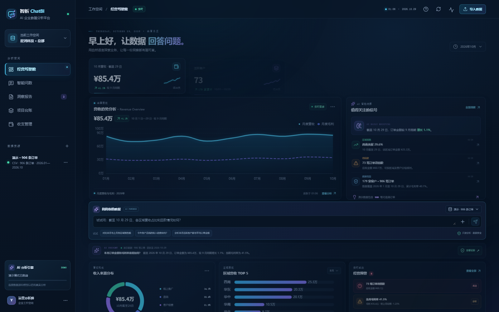

# 智析 ChatBI

> AI 对话式企业数据分析与可视化平台 · 第九届传智杯 AI WEB 开发挑战赛参赛作品

智析 ChatBI 让业务人员用一句中文问题完成“取数—分析—成图—解释”。平台把自然语言理解、受控分析 Agent、只读 SQL 网关、Python 沙箱和语义图谱组合成一条可审计、可回放、可验证的分析链路：模型负责理解与表达，运行时负责边界与证据，页面负责把结论、图表和依据放在同一个工作台里。



## 项目解决什么问题

传统 BI 的分析链路是“业务提需求 → 分析师排期 → 写 SQL → 配图表 → 解释口径”，周期长、门槛高、结论难追溯。大模型聊天工具能回答问题，但经常无法证明数字来自哪里，也不敢接入企业真实库。

智析 ChatBI 的答案是：**对话式交互 + 受控执行 + 证据链**。

- 对话即查询：中文问题直接进入分析流程，不需要写 SQL、拖字段、配图表。
- 受控执行：模型只能调用 4 个白名单工具，SQL 只读、结果限流、脚本隔离。
- 证据可查：每个结论回指 SQL 审计、查询结果、Artifact 与引用材料。
- 演示可复现：没有模型 Key、没有企业数据时，仍可用 906 条合成订单完整演示。
- 真实可落地：支持 CSV / SQLite / MySQL，字段遮蔽确认后才能创建真实 Run。

## 核心功能

| 模块 | 能力 |
| --- | --- |
| 经营驾驶舱 | 订单金额、活跃客户、客单价、毛利率；月度营收/毛利趋势、收入来源、区域 TOP5、经营预警 |
| 智能问数 | 推荐问题、中文提问、DeepSeek 流式回答、失败降级、来源与截至日期标识 |
| 受控分析工作台 | Session / Run、阶段事件、Trace DAG、工具调用、SQL 审计、Artifact、证据引用、历史回放 |
| DataLink 语义图谱 | Schema 建图、业务实体/属性/关系、字段映射、Join 线索、版本与修订、MCP 语义检索 |
| 数据资产 | CSV / SQLite 上传、MySQL 连接、Schema 检查、字段遮蔽确认、DataLink 构建 |
| 模型设置 | OpenAI-compatible 配置、能力探测、测试、激活；密钥只存服务端 |
| 洞察报告 | 结论、口径、证据状态、限制说明、Markdown 导出 |
| 项目台账 / 收支管理 | 项目阶段与进度、收入/成本/回款明细（演示记录，不写外部系统） |

## 技术架构

```text
Browser (Vue 3 + TS + Pinia + ECharts)
   │  HTTP / SSE
   ▼
FastAPI 主服务 (8280, 单 worker)
   ├── Session / Run / Event / Artifact API
   ├── DeepSeek Responses 流式代理（密钥仅服务端）
   └── 受控分析运行时
         ├── Agent Runtime（LangGraph 状态机 + 4 个白名单工具）
         ├── SQL 只读网关（SQLGlot AST + 字段白名单 + LIMIT + 审计）
         ├── Python Docker Sandbox（无网络 / 只读 / 资源限额）
         └── DataLink 客户端（REST + MCP）
   │
   ├── Metadata SQLite（Session / Run / Event / Audit / Artifact）
   └── storage/（datasources / artifacts / traces / workspaces）

DataLink 语义服务 (8281)  ← Schema 建图 / 语义检索 / 版本管理 / MCP
DeepSeek Responses API    ← deepseek-flash（stream=true）
```

**目录结构**

```text
apps/web                 Vue 3 前端（4 个路由、40 个测试文件）
apps/api                 FastAPI 主服务（application / runtime / server）
packages/agent_runtime   受控分析 Agent（状态机、合同、校验、上下文预算）
packages/data_gateway    SQL 只读网关与连接器
packages/contracts       跨层数据契约与 Run 事件
packages/metadata        SQLAlchemy 模型与仓储（17 张表、31 个迁移）
services/datalink        语义图谱服务（REST + MCP）
data/demo                906 条演示订单与汇总
data/benchmark           20 题中文电商评测集（gold SQL + 期望答案）
docs                     18 份开发文档（Markdown + Word）
tests                    后端测试（46 个文件）
```

## 快速开始

### 环境要求

- Windows 10/11
- Python 3.12（`py -3.12`）
- Node.js 22.12 或更新版本
- Docker（仅真实 Python 分析产物需要；演示与 SQL 分析不依赖）
- 可选：DeepSeek API Key（不配置时自动进入演示模式）

### 一键启动

首次运行：

```bat
安装并启动智析ChatBI.bat
```

后续启动 / 停止 / 状态：

```bat
启动智析ChatBI.bat
停止智析ChatBI.bat
查看智析ChatBI状态.bat
```

启动完成后：

| 服务 | 地址 |
| --- | --- |
| Web | http://127.0.0.1:5280/workspace |
| API | http://127.0.0.1:8280/health |
| DataLink | http://127.0.0.1:8281/health |

### 手动启动

```powershell
py -3.12 -m venv .venv
.venv\Scripts\python.exe -m pip install uv
.venv\Scripts\uv.exe sync --locked --group dev
powershell -ExecutionPolicy Bypass -File scripts\install-frontend.ps1
.venv\Scripts\python.exe -m tools.prepare_local
.venv\Scripts\python.exe -m alembic upgrade head
powershell -ExecutionPolicy Bypass -File scripts\dev-services.ps1 -Action Start
```

### 环境变量

复制 `.env.example` 为 `.env`，按需填写。**不要把 `.env` 提交到仓库。**

| 变量 | 必填 | 说明 |
| --- | --- | --- |
| `SECRET_MASTER_KEY` | 生产必填 | 服务端加密模型凭据；本地可留空 |
| `DEEPSEEK_API_KEY` | 可选 | 启用真实 DeepSeek 问数；缺失时进入演示模式 |
| `DEEPSEEK_BASE_URL` | 否 | 默认 `https://api.deepseek.com` |
| `DEEPSEEK_MODEL` | 否 | 默认 `deepseek-flash` |
| `CORS_ORIGINS` | 是 | 前端来源白名单，默认 `http://localhost:5280` |
| `METADATA_DATABASE_URL` | 是 | 默认 `sqlite+aiosqlite:///./storage/metadata.db` |
| `DATALINK_BASE_URL` / `DATALINK_MCP_URL` | 是 | 默认 `http://localhost:8281` 与 `/mcp` |
| `DATALINK_LLM_*` | 建图时 | DataLink 建图模型配置，密钥只走环境变量 |

完整的 100+ 项配置见 [.env.example](.env.example)，含义与默认值见 [16-部署发布手册](docs/16-部署发布手册.md)。

## 测试与质量

```powershell
# 后端（默认排除 live_model / live_docker）
.venv\Scripts\python.exe -m pytest

# 前端
npm run test
npm run typecheck
npm run build

# SQL 规范
.venv\Scripts\ruff.exe check apps\api packages tests tools
```

当前本地基线：后端 Pytest **772 项通过**，前端 Vitest **40 个文件 / 282 项通过**，Ruff、vue-tsc 与 Vite 生产构建通过。AI 质量另有 20 题中文电商基准（0.05% 数值容差 + 单元格匹配）、178 条 Run 协议路由用例与 Prompt A/B 实验脚本，详见 [07-AI技术方案说明书](docs/07-AI技术方案说明书.md)。

> 说明：仓库中的 `live_model` / `live_docker` 用例默认不进入门禁，需要真实 Key 或本地 Sandbox 镜像时单独执行。

## 文档

| 文档 | 内容 |
| --- | --- |
| [01-软件需求规格说明书](docs/01-软件需求规格说明书.md) | 角色、场景、FR/NFR、业务规则、验收基线 |
| [02-系统架构设计说明书](docs/02-系统架构设计说明书.md) | 分层、组件、三条链路、数据表、部署与可靠性 |
| [03-功能设计说明书](docs/03-功能设计说明书.md) | 模块、流程、状态、逐功能规则 |
| [04-UI-UX设计说明](docs/04-UI-UX设计说明.md) | 视觉系统、布局、动效、无障碍 |
| [05-详细设计说明书](docs/05-详细设计说明书.md) | 前后端模块、Run、DeepSeek、资源释放 |
| [06-数据与接口设计说明书](docs/06-数据与接口设计说明书.md) | 字段字典、HTTP、SSE、状态码 |
| [07-AI技术方案说明书](docs/07-AI技术方案说明书.md) | 选型、Agent、工具、预算、评测、隐私 |
| [09-测试计划与测试用例](docs/09-测试计划与测试用例.md) | 用例与退出条件 |
| [10-测试报告](docs/10-测试报告.md) | 执行结果与演示数据核对 |
| [13-系统使用说明及操作手册](docs/13-系统使用说明及操作手册.md) | 启动、问数、数据源、模型、排错 |
| [14-编译构建指南](docs/14-编译构建指南.md) | 锁定依赖、迁移、构建 |
| [16-部署发布手册](docs/16-部署发布手册.md) | 环境变量、生产部署、监控、回滚 |

完整索引见 [docs/README.md](docs/README.md)。

## 安全边界

- API Key 只从服务端环境变量读取，不进入前端 bundle、浏览器存储、日志或文档。
- SQL 经过 SQLGlot AST 只读校验，拒绝写语句；默认 `LIMIT 100`，最大 `LIMIT 500`。
- Python 分析在 Docker 中执行：`--network none`、`--cpus 1`、`--memory 512m`、`--pids-limit 64`、`--cap-drop ALL`、只读根文件系统。
- 字段遮蔽需显式确认，未确认的数据源不能创建真实 Run。
- 演示数据为合成数据，页面与报告始终标注“演示”来源。

## 开源基线

本项目在开源项目 **DataPilot**（[GitHub](https://github.com/w402116500/DataPilot)）的受控数据分析工作台基础上进行二次开发。DataPilot 为本团队指导教师门下学生的作品，**已获得原作者许可**；本作品在其基础上完成了中文企业场景产品化、经营驾驶舱、DeepSeek 流式问数、演示数据、证据呈现、评测体系与交付工程等改造。基线的版权与署名按原作者约定保留。

## 团队

| 项目 | 内容 |
| --- | --- |
| 团队名称 | Team YK |
| 所属院校 | 广东东软学院 |
| 团队成员 | 叶锦豪、洪富凯 |
| 指导教师 | 黄淳笙 |
| 作品编号 | 待组委会分配 |

> 提交前如需补充联系方式或作品编号，请在 README、技术文档封面与作品介绍文档中同步修改。

## 版本

V1.0.1 · 2026-10-31 · 详见 [18-版本变更记录](docs/18-版本变更记录.md)
