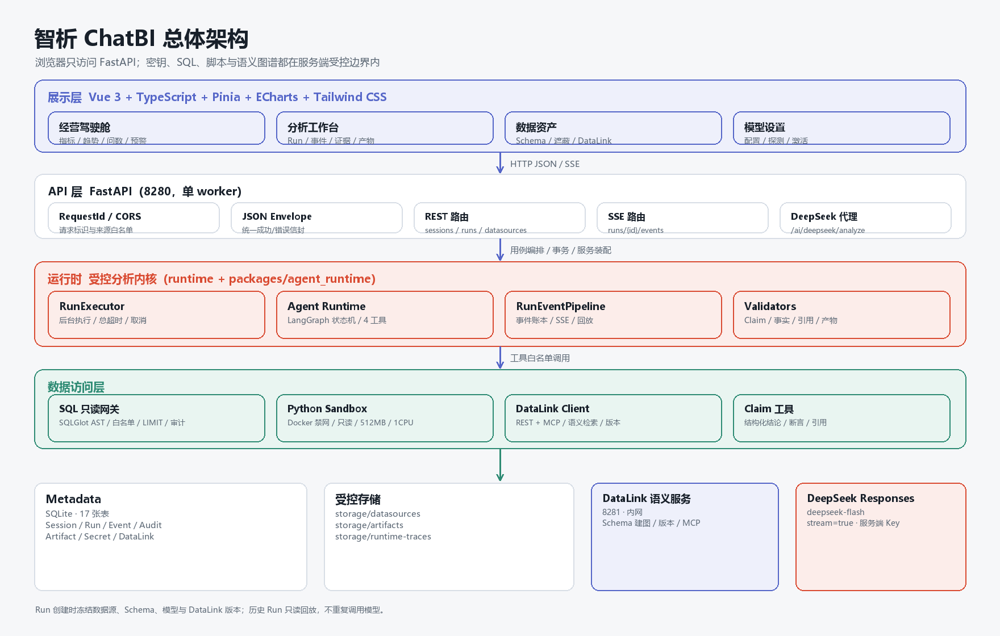
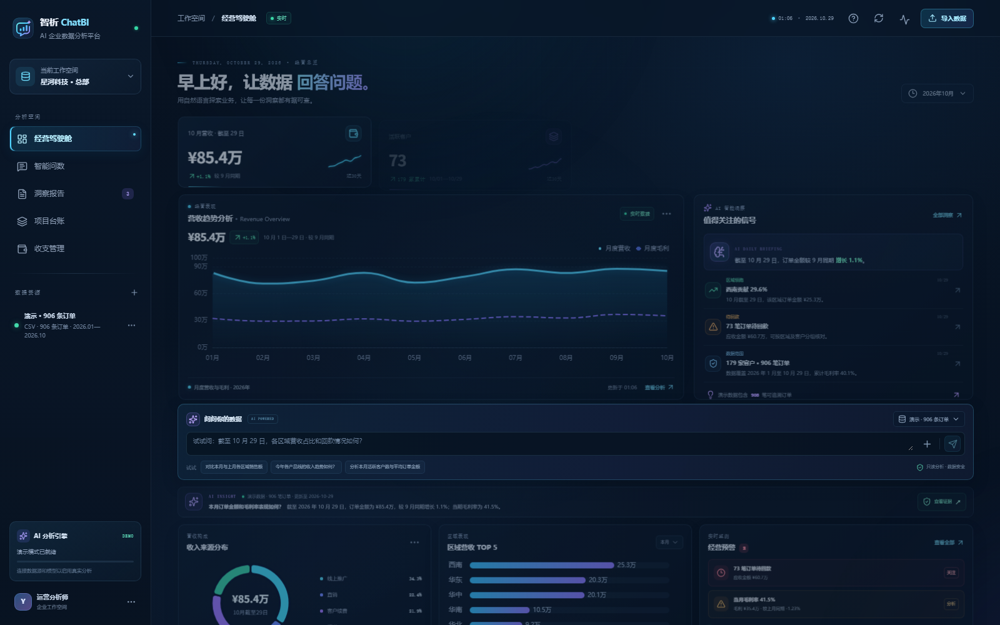
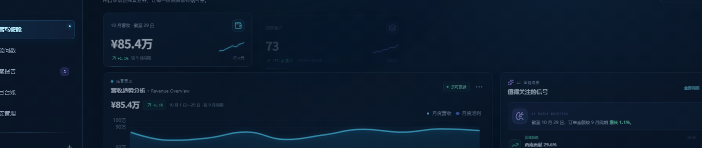
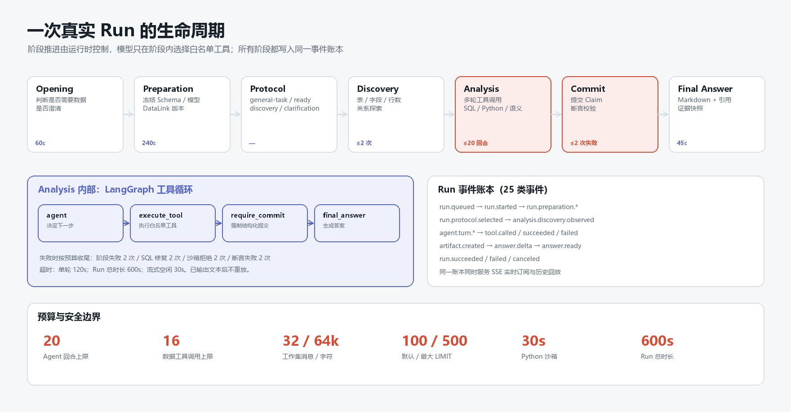
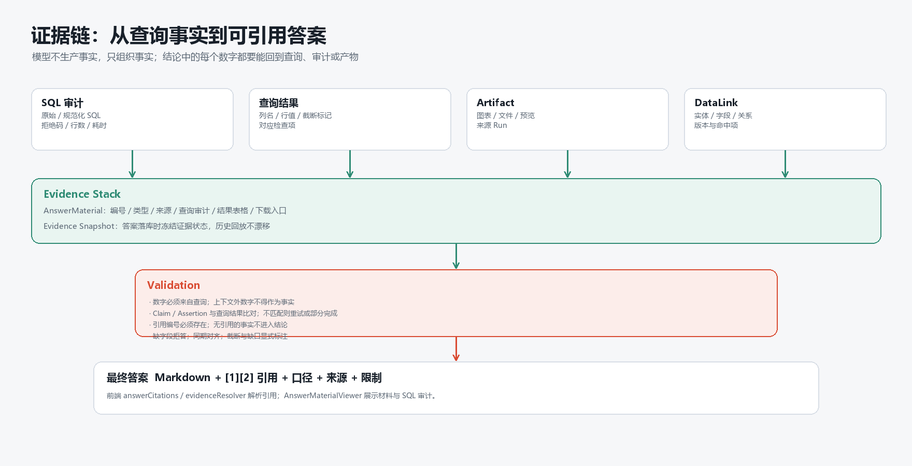

# 智析 ChatBI 作品介绍文档

## 1 项目详情及使用方式

### 1.1 一句话介绍

**智析 ChatBI 是一个用自然语言完成企业数据查询、分析、成图与解释的 AI 分析平台：业务人员像聊天一样提问，系统在受控边界内查询数据，并把结论、图表、SQL 审计与证据一起呈现。**

| 项目 | 内容 |
| --- | --- |
| 作品名称 | 智析 ChatBI——AI 对话式企业数据分析与可视化平台 |
| 参赛赛题 | 第九届传智杯 AI WEB 开发挑战赛 · AI 数据分析与可视化 |
| 作品形态 | Web 应用（Vue 3 前端 + FastAPI 后端 + 独立语义服务） |
| 运行方式 | Windows 本地一键启动；可选公网部署 |
| 演示数据 | 906 条合成订单，2026-01-01 至 2026-10-29 |
| 核心特色 | 自然语言问数、受控 Agent、SQL 只读网关、证据链、DataLink 语义图谱 |

### 1.2 要解决的问题

| 问题 | 传统方式 | 智析 ChatBI |
| --- | --- | --- |
| 分析门槛高 | 业务人员需要懂表结构、SQL、图表配置 | 用中文提问，系统自动取数、成图、解释 |
| 分析链路长 | 提需求、排期、取数、做图由不同角色接力 | 对话即查询、对话即分析、对话即可视化 |
| 结论不可信 | 聊天工具给出的数字没有来源 | 每个数字回指 SQL 审计、查询结果或 Artifact |
| 接入不安全 | 让模型自由生成 SQL 并连接数据库 | 模型只能调用白名单工具，SQL 只读，脚本隔离 |
| 评审难复现 | 依赖真实 Key、企业数据、复杂环境 | 无 Key 也能用 906 条订单完整演示 |

### 1.3 产品形态与功能模块

平台由四个页面组成：

| 页面 | 路由 | 作用 |
| --- | --- | --- |
| 经营驾驶舱 | `/workspace` | 指标、趋势、渠道、区域、预警、问数、报告、台账、收支 |
| 分析工作台 | `/analysis` | Session / Run、阶段事件、Trace DAG、SQL 审计、Artifact、证据 |
| 数据资产 | `/datasources` | CSV / SQLite / MySQL 接入、Schema、字段遮蔽、DataLink |
| 模型设置 | `/settings/model` | 模型配置、能力探测、测试、激活 |

核心模块与能力：

| 模块 | 能力 |
| --- | --- |
| 经营驾驶舱 | 订单金额、活跃客户、平均订单金额、累计毛利率；月度营收/毛利趋势；收入来源环图；区域 TOP5；经营预警 |
| 智能问数 | 中文提问、推荐问题、DeepSeek 流式回答、失败降级、来源与截至日期标识 |
| 受控分析工作台 | Run 生命周期、25 类事件、工具调用、SQL 审计、Artifact、引用材料、历史回放 |
| DataLink 语义图谱 | Schema 建图、业务实体/属性/关系、字段映射、Join 线索、版本与修订、MCP 检索 |
| 数据资产 | CSV / SQLite 上传、MySQL 连接、Schema 检查、遮蔽确认、DataLink 构建 |
| 模型设置 | OpenAI-compatible 配置、能力测试、激活；密钥只存服务端 |
| 洞察报告 | 结论、口径、来源、证据状态、限制、Markdown 导出 |
| 项目台账 / 收支管理 | 项目阶段、负责人、进度、交付；收入/成本/回款/明细（演示记录） |

### 1.4 技术架构



浏览器只访问 FastAPI；密钥、SQL、脚本执行和语义图谱都在服务端受控边界内。DataLink 作为独立语义服务，不向浏览器暴露；DeepSeek 只由主 API 出站调用。

### 1.5 使用方式

#### 1.5.1 环境要求

- Windows 10/11
- Python 3.12
- Node.js 22.12 或更新版本
- Docker（仅真实 Python 分析产物需要）
- 可选：DeepSeek API Key

#### 1.5.2 一键启动

首次运行根目录：

```bat
安装并启动智析ChatBI.bat
```

后续运行：

```bat
启动智析ChatBI.bat
停止智析ChatBI.bat
查看智析ChatBI状态.bat
```

启动后访问：

| 服务 | 地址 |
| --- | --- |
| Web | http://127.0.0.1:5280/workspace |
| API 健康检查 | http://127.0.0.1:8280/health |
| DataLink 健康检查 | http://127.0.0.1:8281/health |

#### 1.5.3 演示模式：5 分钟体验路径

1. 打开 `/workspace`，查看四张指标卡、营收趋势、AI 洞察、收入来源、区域 TOP5 与经营预警。
2. 在“问问你的数据”输入框输入：**“截至 10 月 29 日，各区域营收占比和回款情况如何？”**
3. 点击发送，观察分析状态与流式回答（配置 Key 时走 DeepSeek，未配置时走本地确定性回答）。
4. 查看答案卡的结论、来源、时间范围与“查看证据”入口。
5. 切换到“洞察报告”，查看报告结构并点击“导出最新报告”下载 Markdown。
6. 切换到“项目台账”“收支管理”，查看演示业务模块。
7. 打开 `/analysis` 查看分析工作台；打开 `/datasources` 查看数据源与 DataLink 入口；打开 `/settings/model` 查看模型配置。

#### 1.5.4 真实模式：接入企业数据

1. 在 `/datasources` 上传 CSV / SQLite 或填写 MySQL 连接。
2. 等待 Schema 检查完成，阅读字段目录与敏感字段建议。
3. 显式确认字段遮蔽清单（`mask_fields_confirmed`）。
4. 在 `/settings/model` 新增 OpenAI-compatible 模型，填写 Base URL、模型名与 Key，点击“测试配置”，通过后激活。
5. 在 `/analysis` 新建 Session，选择已 ready 的数据源，提交问题。
6. 在运行检查台查看阶段、工具调用、SQL 审计、Artifact 与证据。

#### 1.5.5 推荐体验问题

- 截至 10 月 29 日，各区域营收占比和回款情况如何？
- 本月哪个渠道贡献最高？环比变化如何？
- 哪些订单待回款？金额和客户分布怎样？
- 2026 年 1–10 月营收和毛利趋势如何？
- 当前数据有哪些字段缺失或质量问题？

### 1.6 交付清单

| 材料 | 说明 |
| --- | --- |
| 源码仓库 | 前端、后端、Agent Runtime、DataLink、测试与文档 |
| README | 项目介绍、架构、安装运行、环境变量、团队信息 |
| 技术文档 PDF | 26 页，覆盖概述、需求、架构、AI 方案、实现、测试部署、创新点 |
| 作品介绍文档 | 本文件 |
| 演示视频 | 5–8 分钟，项目介绍 + 核心功能 + AI 亮点 |
| 环境配置 | `.env.example`、`uv.lock`、`package-lock.json`、启动脚本 |

## 2 项目亮点

### 2.1 产品亮点

**亮点 1：对话即分析，而不是聊天窗 + 图表。**

输入框位于驾驶舱中部偏下，是页面的交互中心。提问后，答案、图表、来源与证据在同一工作台呈现，用户不需要在聊天工具、SQL 客户端和 BI 工具之间切换。

**亮点 2：结论可查，每个数字都有依据。**

答案中的数字附引用编号；证据入口可展开 SQL 审计、查询结果、Artifact 与 DataLink 命中项；答案落库时保存 Evidence Snapshot。它把“AI 说的”变成“有依据的分析”。

**亮点 3：经营驾驶舱 + 问数 + 报告 + 台账 + 收支一体化。**

不只是问数 Demo，而是把企业经营常用的驾驶舱、洞察报告、项目台账与收支管理放进同一产品，形成可演示、可扩展的业务闭环。

**亮点 4：无 Key 也能完整评审。**

没有 DeepSeek Key、没有企业数据时，系统使用 906 条合成订单与统一汇总 JSON，仍可完成驾驶舱浏览、自然语言提问、报告导出与演示。评审不需要申请 Key 或准备数据库。

**亮点 5：业务词到物理字段的最后一公里。**

用户说“回款”“区域”“客户”“订单明细”，DataLink 把业务词映射到字段、实体与 Join 路径，减少模型猜字段和错误关联；语义地图有版本与修订，Run 创建时冻结版本。

**亮点 6：安全边界做成了产品能力。**

字段遮蔽确认、只读 SQL、Docker 沙箱、密钥托管、日志脱敏不是文档里的承诺，而是页面状态、接口冲突（409）、审计记录与运行预算的一部分。

### 2.2 技术亮点

**技术亮点 1：受控 Agent Runtime，而不是自由 ReAct。**

固定“Opening → Preparation → Protocol → Discovery → Analysis → Commit → Final Answer”的阶段，模型只能在阶段内选择 4 个白名单工具，并受回合、工具、失败、SQL 修复、沙箱拒绝、断言失败等多重预算约束。自由 Agent 的无限试错与不可复现，被转化为有界失败和可读终态。

**技术亮点 2：SQL 只读网关 + Docker 无网络沙箱。**

SQL 经 SQLGlot AST 校验，拒绝写语句、越权表/字段，强制 LIMIT 与超时，并记录每次尝试；复杂计算进入 `--network none`、`--cap-drop ALL`、只读根文件系统、512MB / 1CPU / 64 PID 的沙箱。模型没有任何直接写库或联网执行代码的能力。

**技术亮点 3：Claim / Assertion / Evidence 证据链。**

模型在最终答案前必须提交结构化 Claim；运行时把需求拆成 Assertion，与查询结果比对；答案数字绑定材料编号；答案落库时保存 Evidence Snapshot。结论不是“模型说的”，而是“查询事实 + 校验 + 引用”的组合。

**技术亮点 4：同一事件账本服务 SSE 与历史回放。**

25 类 Run 事件既是实时推送的事实，也是历史回放的事实；前端用同一套投影逻辑处理实时与回放，避免“实时状态”和“历史记录”双写不一致。

**技术亮点 5：AI 质量可回归。**

配套 20 题中文电商基准、178 条协议路由用例、Prompt A/B 脚本与答案数字审计；改动提示、工具或模型后可重跑，而不是“演示一次就结束”。

### 2.3 与常见方案的差异

| 维度 | 聊天工具 + CSV | 传统 BI | 智析 ChatBI |
| --- | --- | --- | --- |
| 使用门槛 | 低 | 高 | 低 |
| 数据接入 | 手工上传 | 建模后接入 | CSV / SQLite / MySQL |
| 结论来源 | 常无来源 | 报表口径 | SQL 审计 + Artifact + 引用 |
| 写库风险 | 取决于工具 | 受权限控制 | 只读网关 + 沙箱 |
| 语义映射 | 无 | 人工建模 | DataLink 图谱 + MCP |
| 可回放 | 弱 | 报表历史 | Run 事件账本 |
| 评审可复现 | 需 Key | 需环境 | 演示模式无需 Key |

## 3 AI 技术落地与测试评测情况

### 3.1 模型选型与集成

主分析模型使用 **DeepSeek deepseek-flash**，通过 OpenAI Python SDK 的 **Responses API** 接入，`base_url=https://api.deepseek.com`，`stream=true`。

选择理由：中文业务词理解稳定、支持工具调用、支持流式输出、OpenAI-compatible 便于替换、flash 档位成本适合演示与多次回归。模型通过 ModelProfile 可替换，不是硬编码。

集成方式：

- 浏览器只调用 `POST /ai/deepseek/analyze`，请求体只有 `question`。
- 服务端从环境变量读取 Key，调用模型，把 `output_text.delta` 映射为 SSE `delta`，`completed` 映射为 `done`。
- 401/402 不重试；timeout/connection/429/5xx 仅在未输出文本时有限退避；已输出文本后不重放。
- 浏览器不直连模型服务，Key 不进入前端 bundle、Storage、日志、报告与截图。

### 3.2 Agent 与工具落地

受控 Agent 基于 LangGraph 构建，节点为 `agent → execute_tool → require_commit → final_answer`，阶段为 `Opening → Preparation → Protocol → Discovery → Analysis → Commit → Final Answer`。

模型只能调用 4 个工具：

| 工具 | 作用 | 边界 |
| --- | --- | --- |
| `run_sql_readonly` | 只读查询 | AST 校验、字段白名单、LIMIT、超时、审计 |
| `run_python` | 计算与产物 | Docker 禁网、限资源、固定入口 |
| `explore_datalink` | 语义检索 | MCP、版本化、消费记录 |
| `commit_analysis_claims` | 提交结构化结论 | Claim/Assertion 合同、事实校验、引用绑定 |

预算：20 回合、16 次数据工具调用、2 次阶段失败、2 次 Claim 校验失败、2 次沙箱拒绝、2 次 SQL 修复、2 次 Discovery 尝试、32 条消息 / 64000 字符工作集、8 个断言、每断言 3 次查询。

### 3.3 可信与安全落地

- SQL 只读：拒绝写语句、越权表/字段；默认 LIMIT 100，最大 500；单次 60 秒；每次尝试写入审计。
- Python 沙箱：`--network none`、`--cpus 1`、`--memory 512m`、`--pids-limit 64`、`--cap-drop ALL`、只读根文件系统；30 秒。
- 字段遮蔽：显式确认；未确认时创建 Run 返回 409；遮蔽字段不进入 Schema、SQL、上下文与报告。
- 证据链：Claim / Assertion / 事实校验 / 结果校验 / 引用编号 / Evidence Snapshot。
- 密钥：只从服务端环境变量或加密 Secret 读取；日志不记录 Authorization、Key、完整查询结果。

### 3.4 测试与评测落地情况

| 类型 | 规模 | 结果 / 用途 |
| --- | --- | --- |
| 后端 Pytest | 772 项 | 通过；覆盖 Agent、SQL 网关、Run、DataLink、模型、工具、安全、迁移 |
| 前端 Vitest | 40 个文件 / 282 项 | 通过；覆盖组件、stores、事件投影、引用、布局、主题 |
| DeepSeek 单测 | 6 项 | 通过；覆盖流式事件映射与错误分类 |
| 类型与构建 | vue-tsc、Vite build | 通过 |
| 规范 | Ruff（E/F/I/UP/B） | 通过 |
| 中文电商基准 | 20 题 | gold SQL + 期望答案 + 结构 lint + 0.05% 容差 + 单元格匹配 |
| 协议路由语料 | 178 条 / 11 类 | 覆盖率评估：模式、终态、资源类型、失败分布 |
| Prompt A/B | 多变体 | 记录变体、耗时、token 与结构化结果 |
| 答案数字审计 | 脚本 | 检查答案数字与查询结果一致性 |
| 真实依赖 | `live_model` / `live_docker` | 默认排除，需真实 Key / 镜像时单独执行 |

测试与评测的价值：

1. **可回归**：改动提示、工具、模型后，重跑基准与路由用例，避免“改一处坏一片”。
2. **可解释**：评分按 0.05% 数值容差与单元格匹配，避免“看起来差不多”的模糊判断。
3. **可维护**：题库维护约定明确“题面是唯一真相，gold 冲突时修 gold”，并有结构 lint 防止题面与 gold 分家。
4. **可演示**：真实依赖默认不进入门禁，评审环境不需要 Key 或 Docker 也能跑通大部分测试。

### 3.5 落地结论

AI 能力不是“接了一个模型”，而是被放进受控运行时：模型负责理解与表达，运行时负责工具、边界、预算与证据。当前版本已在本机演示环境验证驾驶舱、问数、流式回答、分析工作台、DataLink、证据链与一键启动；真实企业数据、组织权限与生产规模性能需在目标环境另行验收。

## 4 项目中涉及的关键技术

| 关键技术 | 在本项目中的用途 |
| --- | --- |
| 大语言模型 / Responses API | 中文问题理解、计划、工具选择、结论组织、流式回答 |
| LangGraph / LangChain | 受控 Agent 状态机、节点编排、工具循环、可选 LangSmith Trace |
| Prompt / JSON Schema 合同 | 计划、断言、Claim 的结构化约束，减少自由文本歧义 |
| SQLGlot AST | SQL 只读校验、写语句拒绝、表/字段白名单、LIMIT 控制 |
| SQLAlchemy / Alembic / SQLite | 17 张元数据表、31 个迁移、Run/Event/Audit/Artifact 持久化 |
| FastAPI / SSE | REST API、流式事件、错误信封、单 worker 运行时 |
| Docker Sandbox | Python 分析隔离：禁网、限 CPU/内存/PID、只读根文件系统 |
| MCP / DataLink | 业务实体、属性、字段、关系、Join 线索的语义检索与版本管理 |
| Vue 3 / TypeScript / Pinia | 前端组件化、状态管理、路由、事件投影 |
| ECharts | 趋势、环图、区域排行等可视化 |
| Tailwind CSS 4 / CSS 变量 | 深海玻璃视觉、响应式、主题与动效 |
| Pydantic v2 | 跨层契约、请求校验、事件与工具参数约束 |
| 加密 Secret / 环境变量 | 模型密钥托管、日志脱敏、前端不可见 |
| Pytest / Vitest / Ruff | 后端、前端、规范与回归测试 |

## 5 项目相关的图片 / 照片

### 5.1 经营驾驶舱全景



驾驶舱包含指标卡、营收趋势、AI 洞察、问数输入、答案卡、收入来源、区域 TOP5 与经营预警；页面明确标注“演示 · 906 条订单”。

### 5.2 指标、趋势与 AI 洞察



指标卡先给数值与变化，再给口径；趋势图展示 2026 年 1–10 月月度营收与毛利；AI 洞察列出区域占比、待回款与毛利率变化。

### 5.3 收入来源、区域排行与经营预警


环图展示当月收入来源；横向柱状图展示区域 TOP5；预警区展示 73 笔待回款与当月毛利率变化。

### 5.4 总体技术架构


展示层、API 层、运行时、数据访问层、持久化与外部服务的分层关系，以及浏览器、FastAPI、DataLink、DeepSeek 的边界。

### 5.5 一次真实 Run 的生命周期



从 Opening 到 Final Answer 的阶段推进、LangGraph 工具循环、25 类事件账本、预算与安全边界。

### 5.6 证据链



从 SQL 审计、查询结果、Artifact、DataLink 到可引用答案的完整链路。

## 6 项目之前是否发表过或获奖

本作品为团队为第九届传智杯 AI WEB 开发挑战赛首次提交的参赛作品，**此前未在其他赛事发表、展示或获奖**，也未以论文、专利、软著等形式公开发表。

需要说明的边界：

- 作品中的演示数据为合成数据，不涉及真实企业商业秘密。
- 作品使用的开源基线已获得原作者许可；按原作者约定保留版权与来源说明。
- 若后续参加其他赛事、发表或申请知识产权，团队将同步更新本节与仓库说明。

## 7 若项目是在其他项目基础上优化，请说明优化部分

### 7.1 基线来源

本项目在开源项目 **DataPilot**（GitHub：`https://github.com/w402116500/DataPilot.git`，本地源码目录 `DataPilot-main`）的受控数据分析工作台基础上进行二次开发。基线提供了“自然语言问数 + 受控分析工作台 + 只读数据访问 + 语义地图”的思路与部分基础能力；本作品在其上完成了产品化、场景化、可视化、演示化与评测化的改造。

> 说明：本项目基于 DataPilot 二次开发，**已获得原作者许可**。本作品不声称从零实现基线已有的全部能力；涉及基线的版权、许可证与署名要求，按原作者约定保留。

### 7.2 保留与复用的部分

| 方向 | 说明 |
| --- | --- |
| 受控分析思路 | 保留“模型只调用受控工具、数据访问有边界”的核心思路 |
| 运行检查台 | 保留 Run / 事件 / 工具 / 产物 / 审计的检查视角 |
| 只读数据访问 | 保留 SQL 只读与结果限流的基线能力 |
| 语义地图 | 保留 Schema → 实体 / 属性 / 关系的语义建图思路 |
| 元数据与事件 | 保留以 Run 为中心、以事件记录过程的建模方式 |

### 7.3 二次开发与优化清单

| 方向 | 基线形态 | 本作品的优化 |
| --- | --- | --- |
| 产品定位 | 通用数据分析工作台 | 面向企业经营场景的“智析 ChatBI”，明确业务用户、分析师、模型管理员、评审四类角色 |
| 品牌与文案 | 基线品牌与英文/通用文案 | 统一 ChatBI 标识、中文信息架构、中文错误提示与操作手册 |
| 业务模块 | 以分析工作台为主 | 新增经营驾驶舱、洞察报告、项目台账、收支管理，形成业务闭环 |
| 视觉设计 | 通用深色工作台 | 深海黑 + 朱砂橙 + 蓝紫焦点的玻璃视觉；指标、趋势、问数、洞察、预警的层级重排 |
| 演示能力 | 依赖真实数据源与模型配置 | 新增 906 条合成订单、统一 summary、无 Key 本地降级、演示/真实来源标签 |
| 模型接入 | 通用 OpenAI-compatible | 新增 DeepSeek Responses 流式接入、SSE 事件映射、401/402/超时/429/5xx 分类与有限重试 |
| 证据呈现 | 运行检查台视角 | 新增引用编号、AnswerMaterialViewer、Evidence Snapshot、报告导出与缺口提示 |
| 安全边界 | 基础密钥与只读能力 | 新增 SecretCipher、遮蔽显式确认（409）、构建产物扫描、日志脱敏、Docker 沙箱参数固化 |
| 评测体系 | 无固定题库 | 新增 20 题中文电商基准、178 条协议路由、Prompt A/B、答案数字审计、live 标记 |
| 交付工程 | 开发脚本为主 | 新增 Windows 一键安装/启动/停止/状态、健康检查、环境模板、18 份开发文档与提交材料 |
| 文档体系 | 少量说明 | 新增需求、架构、功能、UI、详细设计、接口、AI、测试、部署、验收等 18 份文档 |
| 演示一致性 | 旧品牌截图与旧数据 | 重新生成与当前代码一致的驾驶舱截图，统一品牌与 906 条订单口径 |

### 7.4 优化边界

- 保留基线的受控分析内核与部分基础能力，不对其原创性作虚假声称。
- 本作品的重点增量是：中文企业场景产品化、驾驶舱与业务模块、DeepSeek 流式接入、证据链呈现、演示降级、评测体系与交付工程。
- 若评审需要区分“基线能力”与“本作品新增能力”，以本节清单与 Git 提交记录为准。
- 已获得 DataPilot 原作者许可；按原作者约定保留版权与来源说明。

## 8 团队与声明

| 项目 | 内容 |
| --- | --- |
| 团队名称 | Team YK |
| 团队成员 | 叶锦豪、洪富凯 |
| 指导教师 | 黄淳笙 |
| 所属院校 | 广东东软学院 |
| 作品编号 | 待组委会分配 |
| 联系方式 | 待填写 |

**团队分工**

| 成员 | 主要分工 |
| --- | --- |
| 叶锦豪 | 团队负责人；整体统筹、提交材料与演示 |
| 洪富凯 | 技术实现、测试与部署 |
| 黄淳笙 | 指导教师；需求与架构评审 |

**声明**

1. 本作品为团队原创二次开发成果，已获得 DataPilot 原作者许可，基线来源已在第 7 节说明。
2. 演示数据为合成数据，不含真实企业商业秘密。
3. 所有 API Key 均通过环境变量注入，未写入源码、文档、截图或仓库。
4. 本作品不提供写库、DDL/DML、财务决策等高风险能力。
