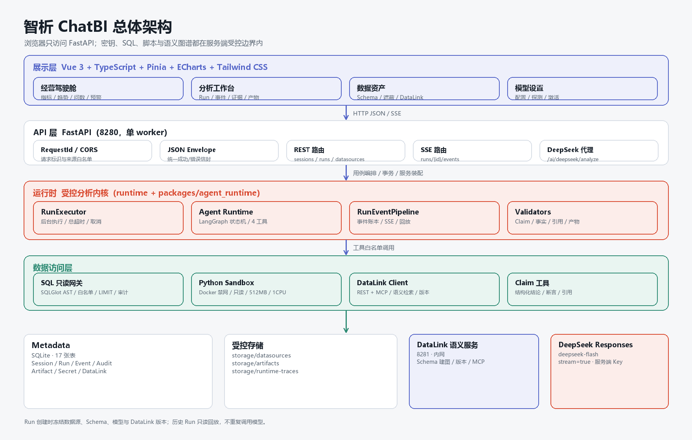
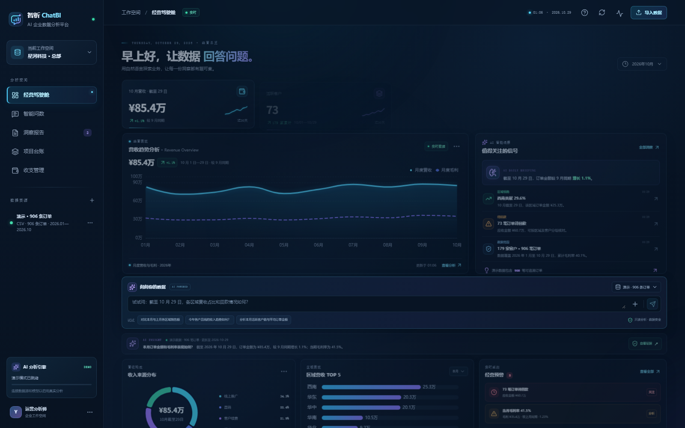

# 智析 ChatBI 技术文档

## 1 项目概述

### 1.1 作品名称与定位

**智析 ChatBI——AI 对话式企业数据分析与可视化平台。**

它不是“聊天窗 + 图表”，而是一套把自然语言、受控执行、证据链和可视化组织在一起的分析工作台：用户用中文提出经营问题，系统在受控边界内完成查询、计算、成图和解释，并把每个结论回指到 SQL 审计、查询结果、Artifact 或语义图谱。

本项目在开源项目 DataPilot 的受控数据分析工作台基础上二次开发，**已获得原作者许可**；基线的版权与署名按原作者约定保留。本作品的重点增量是中文企业场景产品化、经营驾驶舱、DeepSeek 流式问数、演示数据、证据呈现、评测体系与交付工程。

### 1.2 背景与问题

企业并不缺数据，缺的是“把数据变成洞察”的通路。传统 BI 的分析链路是“业务提需求 → 分析师排期 → 写 SQL → 配图表 → 解释口径”，存在四个结构性问题：

| 问题 | 具体表现 | 后果 |
| --- | --- | --- |
| 门槛高 | 需要理解表结构、字段、SQL、图表配置 | 非技术岗位依赖分析师排期 |
| 链路长 | 取数、做图、解释由不同角色接力 | 响应以天或周计 |
| 结论不可信 | 聊天工具给出的数字没有来源 | 无法回答“这个数从哪来” |
| 接入不安全 | 让模型自由生成 SQL 并连库 | 写库、越权、泄露、成本失控 |

智析 ChatBI 的解法是：**对话式交互 + 受控执行 + 证据链 + 可复现演示**。模型负责理解与表达，运行时决定能用什么工具、读什么数据、给出什么证据。

### 1.3 目标用户与价值

| 角色 | 目标 | 平台提供的能力 |
| --- | --- | --- |
| 业务 / 运营 / 销售 | 不写 SQL 也能查数 | 中文提问、推荐问题、图表与结论 |
| 管理者 | 快速看清经营状况 | 驾驶舱、趋势、区域、渠道、预警 |
| 数据分析师 | 核对口径与证据 | Schema、遮蔽、Run、SQL 审计、DataLink |
| 模型管理员 | 安全接入模型 | 配置、能力探测、测试、激活 |
| 评审人员 | 无 Key 验证作品 | 演示模式、906 条订单、完整操作手册 |

价值可以概括为四点：

- **用户价值**：降低分析门槛，让业务人员“像聊天一样问数据”。
- **企业价值**：盘活数据资产，缩短“提问—取数—成图—决策”的链路。
- **技术价值**：探索 AI + BI 的轻量化落地形态，形成可审计的对话式分析闭环。
- **社会价值**：推动数据分析普惠，让非专业用户也具备基本的数据洞察能力。

### 1.4 核心能力

| 模块 | 能力 |
| --- | --- |
| 经营驾驶舱 | 订单金额、活跃客户、客单价、毛利率；月度营收/毛利趋势、收入来源、区域 TOP5、经营预警 |
| 智能问数 | 中文提问、推荐问题、DeepSeek 流式回答、失败降级、来源与截至日期标识 |
| 受控分析工作台 | Session / Run、阶段事件、Trace DAG、工具调用、SQL 审计、Artifact、证据引用、历史回放 |
| DataLink 语义图谱 | Schema 建图、业务实体/属性/关系、字段映射、Join 线索、版本与修订、MCP 语义检索 |
| 数据资产 | CSV / SQLite 上传、MySQL 连接、Schema 检查、字段遮蔽确认、DataLink 构建 |
| 模型设置 | OpenAI-compatible 配置、能力探测、测试、激活；密钥只存服务端 |
| 洞察报告 | 结论、口径、证据状态、限制说明、Markdown 导出 |
| 项目台账 / 收支管理 | 项目阶段与进度、收入/成本/回款明细（演示记录，不写外部系统） |

### 1.5 双模式运行

| 模式 | 触发条件 | 分析路径 | 数据来源 | 页面标识 |
| --- | --- | --- | --- | --- |
| 演示模式 | 无数据源 / 无激活模型 / API 不可用 | 本地确定性回答，或 DeepSeek 聚合上下文 SSE | `chatbi_sales_summary.json` | “演示 · 906 条订单” |
| 真实模式 | 数据源 ready + 遮蔽确认 + 模型激活 | 受控 Agent Run | 数据源只读查询 + Artifact | 数据源名称 + Run 状态 |

演示模式不是“假数据兜底”，而是可独立验收的产品路径：评审不需要 Key、不需要企业数据，也能完成驾驶舱浏览、自然语言提问、报告导出与证据查看。

### 1.6 项目规模

| 维度 | 规模 |
| --- | --- |
| 前端 | Vue 3 + TS + Vite，4 个路由、20+ 核心组件、40 个测试文件 |
| 后端 | FastAPI 单 worker，17 张表、31 个 Alembic 迁移、46 个测试文件 |
| AI 运行时 | LangGraph 状态机、4 个白名单工具、25 类 Run 事件 |
| 测试 | 后端 Pytest 772 项、前端 Vitest 282 项 |
| 评测 | 20 题中文电商基准、178 条协议路由用例 |
| 文档 | 18 份开发文档（Markdown + Word） |

## 2 需求分析

### 2.1 核心用户旅程

| 步骤 | 用户动作 | 系统行为 | 用户看到 |
| --- | --- | --- | --- |
| 1 | 打开 `/workspace` | 加载汇总数据、健康状态与导航 | 指标卡、趋势、渠道、区域、预警、问数框 |
| 2 | 输入“截至 10 月 29 日，各区域营收占比和回款情况如何？” | 校验问题，进入 analyzing | 发送禁用、脉冲状态、来源标签 |
| 3 | 系统分析 | 演示走 DeepSeek SSE；真实模式创建 Run 并订阅事件 | 流式文本 / 阶段事件 |
| 4 | 查看结论 | 组织结论、口径、来源、限制与证据入口 | 答案卡、证据按钮、图表联动 |
| 5 | 追问或导出 | 保留会话上下文；报告导出 Markdown | 新回答、报告文件、历史 Run |

### 2.2 功能需求

| 编号 | 需求 | 优先级 | 验收摘要 |
| --- | --- | --- | --- |
| FR-01 | 工作空间与导航 | P0 | 四个路由可访问，切换不整页刷新 |
| FR-02 | 演示数据与统一汇总 | P0 | 906 条订单，页面指标与 summary 一致 |
| FR-03 | 数据源接入与 Schema | P0 | CSV / SQLite / MySQL 可接入并显示状态 |
| FR-04 | 字段遮蔽与只读边界 | P0 | 未确认遮蔽不能建 Run；写 SQL 被拒绝并审计 |
| FR-05 | 自然语言问数 | P0 | 中文提问、推荐问题、追问、输入校验 |
| FR-06 | DeepSeek 流式分析 | P0 | SSE 返回 status / delta / error / done |
| FR-07 | 受控 Run 与证据链 | P0 | Run 可创建、订阅、取消、回放，证据可定位 |
| FR-08 | 可视化驾驶舱 | P0 | 指标、趋势、渠道、区域、预警完整 |
| FR-09 | 洞察报告 | P1 | 结论、来源、证据、限制可导出 Markdown |
| FR-10 | 项目流程台账 | P1 | 负责人、阶段、进度、交付可见 |
| FR-11 | 收支管理 | P1 | 收入、成本、回款、明细口径可复算 |
| FR-12 | 模型配置安全 | P0 | Key 仅服务端持有，测试通过后才能激活 |
| FR-13 | 演示降级 | P0 | API / Key 不可用时主流程仍可演示 |

### 2.3 非功能需求

| 编号 | 类别 | 要求 | 验证 |
| --- | --- | --- | --- |
| NFR-01 | 性能 | 本地演示首屏 1 秒内出现骨架与指标 | 浏览器 Performance |
| NFR-02 | 流式 | 上游片段到达即转发，不整段缓冲 | SSE 冒烟 |
| NFR-03 | 可用性 | 异常给出原因与下一步，不暴露堆栈 | 异常用例 |
| NFR-04 | 安全 | Key 不进入 bundle、Storage、日志、报告、截图 | 构建产物搜索 |
| NFR-05 | 数据 | SQL 只读、结果限流、审计完整 | 网关单测 |
| NFR-06 | 兼容 | Windows、Python 3.12、Node 22.12+、Edge/Chrome | 构建与手工验收 |
| NFR-07 | 响应式 | 1280 / 768 / 390 可操作，无页面级横向溢出 | 浏览器测量 |
| NFR-08 | 可维护 | 前后端分层、接口有契约、命名一致 | 代码审查 |
| NFR-09 | 可追溯 | P0/P1 有用例与结果 | 追溯矩阵 |
| NFR-10 | 一致性 | 页面指标来自汇总或真实产物 | 数据对账 |
| NFR-11 | 恢复 | 重启恢复中断检查、构建与 Run 终态 | 重启测试 |
| NFR-12 | 可观测 | request_id、run_id、事件序号、日志脱敏 | 日志审查 |

### 2.4 关键业务规则

| 编号 | 规则 |
| --- | --- |
| BR-01 | 页面数字必须来自 CSV 生成的 summary JSON 或真实 Run 产物 |
| BR-02 | 同期比较必须使用相同截止日：10 月 1–29 日对比 9 月 1–29 日 |
| BR-03 | 缺少漏斗字段时不计算转化率；缺少成本字段时不计算毛利率 |
| BR-04 | 待回款只统计 `payment_status=待回款` |
| BR-05 | Key 缺失时显示演示模式，不显示密钥内容 |
| BR-06 | 真实 Run 失败不得覆盖历史成功结果 |
| BR-07 | 报告必须标注演示或真实来源 |
| BR-08 | 未确认遮蔽、Schema 未就绪或模型未激活时不得创建真实 Run |
| BR-09 | 模型不得把上下文外数字当作查询事实；无证据的数字不进入结论 |

### 2.5 范围边界

- 不写入企业业务库，不修改源数据，不提供 DDL / DML。
- 不替用户做财务、投资、人事等高风险决策。
- 不提供企业级多租户、单点登录、行级权限（V1.0 为单工作空间）。
- 不承诺对任意数据源自动建图；DataLink 建图需要模型配置。
- 演示数据为合成数据，项目台账与收支为演示记录。

### 2.6 验收基线

所有 P0 通过；P1 可演示；CSV 与 summary 一致；构建、类型检查、前后端测试、DeepSeek 冒烟、健康检查通过；18 份文档同步；构建产物与仓库中搜索不到真实 Key；`.env`、`storage`、`.venv`、`.tmp` 未提交。

## 3 系统架构设计

### 3.1 架构原则

| 原则 | 落地方式 |
| --- | --- |
| 受控优先 | 模型不直接接触数据库；所有访问经白名单工具、只读网关、沙箱或 DataLink |
| 证据优先 | 事实来自查询；答案与 SQL 审计、Artifact、引用材料绑定 |
| 双模式运行 | 无 Key / 无数据源时演示；配置齐全后切换真实 Run |
| 边界清晰 | 浏览器不持有密钥、不直连模型、不直连 DataLink |
| 单进程一致性 | Run、SSE、取消状态在单 worker 内协作 |
| 可替换模型 | OpenAI-compatible + ModelProfile 抽象供应商 |
| 可观测 | request_id、run_id、事件序号、Trace DAG、可选 LangSmith |

### 3.2 总体架构



架构分为六层：

| 层 | 主要组件 | 职责 | 明确不做 |
| --- | --- | --- | --- |
| 展示层 | 4 个视图、20+ 组件 | 页面、输入、图表、状态 | 不保存 Key、不连库、不直连模型 |
| API 层 | FastAPI routes、middleware | 校验、事务、SSE、错误信封 | 不返回上游原始错误体 |
| 应用层 | RunExecution、DataSource、ModelProfiles | 用例编排、服务装配 | 不直接拼 SQL |
| 运行时 | RunExecutor、Agent Runtime、EventPipeline | 状态机、工具、预算、校验 | 不越过工具白名单 |
| 数据访问 | SQL Gateway、Sandbox、DataLink Client | 只读查询、隔离计算、语义检索 | 不写源库、不联网、不越权读文件 |
| 持久化 | Metadata SQLite、storage | Run/Event/Audit/Artifact/Secret | 不存明文密钥、不记录完整敏感结果 |

### 3.3 三条核心链路

#### 3.3.1 演示问数链路

```text
Browser ──POST /ai/deepseek/analyze──▶ FastAPI
                                      ├─ 读取 DEEPSEEK_API_KEY（服务端）
                                      ├─ 构造受限聚合上下文
                                      ├─ AsyncOpenAI Responses API（stream=true）
                                      └─ delta / completed / error → SSE
Browser ◀──status / delta / error / done── FastAPI
```

401/402 不重试；timeout/connection/429/5xx 仅在未输出文本时退避；已输出文本后不重放。Key 缺失或服务不可用时，前端降级为本地确定性回答。

#### 3.3.2 真实 Run 链路

1. 前端在 `/analysis` 选择 Session 与已 ready 的数据源。
2. `POST /sessions/{id}/runs` 携带问题与幂等键。
3. RunExecution 校验会话、幂等键、活跃 Run；解析并冻结数据源、Schema、模型、DataLink 版本、预算与超时。
4. 写入 `runs`、`messages`，追加 `run.queued` 事件，调度后台执行，返回 202。
5. RunExecutor 执行 Agent Graph；工具调用写入审计与事件；最终答案保存证据快照。
6. 前端通过 SSE 增量投影；历史 Run 只读回放，不重复调用模型。

#### 3.3.3 DataLink 语义链路

```text
Schema ──▶ DataLink（8281）
            ├─ 建图：表→实体，字段→属性，外键/采样→关系与 Join
            ├─ 修订：草稿 → 校验 → 发布版本
            ├─ 检索：MCP 按业务词召回实体、属性、关系、字段映射
            └─ 消费：记录 Run 使用的版本与命中项
```

DataLink 解决“业务词不是物理字段名”的问题：用户说“回款”，图谱把它映射到 `payment_status`；用户说“客户”，图谱给出实体与主键；用户说“订单明细”，图谱给出 Join 路径。

### 3.4 组件与代码边界

| 组件 | 代码位置 | 输入 | 输出 |
| --- | --- | --- | --- |
| 驾驶舱 | `apps/web/src/views/ChatBIDashboard.vue` | summary、用户操作、SSE | 指标、图表、洞察、答案 |
| 分析工作台 | `views/WorkspaceView.vue`、`stores/runStore.ts` | Session、Run 事件 | 时间线、DAG、证据、产物 |
| 数据资产 | `views/DatasourcesView.vue` | 上传/连接、Schema | Schema 卡片、遮蔽、图谱 |
| 模型设置 | `views/ModelSettingsView.vue` | 配置、Key | 测试结果、激活状态 |
| 主 API | `apps/api/server` | HTTP、环境配置 | JSON envelope、SSE |
| Run 创建 | `application/run_execution.py` | Session、问题、幂等键 | Run 记录、排队事件 |
| Run 执行 | `runtime/run_executor.py`、`run_runtime.py` | RunContext | 事件、审计、Artifact、终态 |
| Agent | `packages/agent_runtime/graph.py` | 计划、观察、上下文 | 工具调用、Claim、答案 |
| SQL 网关 | `packages/data_gateway/sql_guard.py` | SQL、Schema | 只读 SQL 或拒绝码 |
| Sandbox | `application/docker_sandbox.py` | 脚本、输入 | 产物、stdout、错误 |
| DataLink | `services/datalink/server` | Schema、修订 | 图谱、语义检索、版本 |
| Metadata | `packages/metadata` | 领域对象 | SQLite 记录 |

### 3.5 数据持久化

| 分组 | 表 | 用途 |
| --- | --- | --- |
| 数据资产 | `data_sources`、`connection_grants`、`secrets` | 数据源、授权、加密凭据 |
| 模型 | `model_profiles` | 服务商、模型、参数、能力快照 |
| 会话 | `sessions`、`session_preferences`、`conversation_context_states`、`historical_answer_summaries` | 会话、偏好、上下文、历史摘要 |
| 消息与 Run | `messages`、`runs` | 问题、答案、Run 上下文与终态 |
| 事件与工具 | `run_events`、`tool_calls` | 事件账本、工具调用摘要 |
| 审计与产物 | `sql_audit_logs`、`artifacts`、`artifact_cleanup_tasks` | SQL 审计、产物、清理 |
| DataLink | `datalink_validations`、`run_datalink_consumptions` | 构建校验、语义消费 |

迁移使用 Alembic，共 31 个版本，覆盖基础元数据、数据源网关、模型运行时、Run 事件、上下文、DataLink 校验与消费。

### 3.6 部署拓扑

| 服务 | 端口 | 运行方式 | 对外暴露 |
| --- | --- | --- | --- |
| Web | 5280 | Vite / 静态构建 | 是 |
| FastAPI | 8280 | Python 3.12、Uvicorn、单 worker | 是（仅 API） |
| DataLink | 8281 | Python 3.12、Uvicorn | 否（内网/本机） |
| DeepSeek | HTTPS | 外部 Responses API | 出站 |

Windows 通过批处理启动三项服务；生产环境使用 HTTPS 反向代理，DataLink 仅内网，storage 与 Metadata 最小权限并定期备份。

### 3.7 可靠性与安全

- `/health` 检查 Metadata、数据源根、Artifact 根与 DataLink；DataLink 不可用返回 `degraded` 而非 500。
- SSE 中断时停止读取并释放 reader；历史事件可重新拉取。
- 服务启动恢复非终态 Run、数据源检查、DataLink 构建与校验。
- Run 创建使用幂等键；同一 Session 只允许一个活跃 Run。
- 取消写入登记，执行器在检查点终止并落 `run.canceled`；总超时默认 600 秒。
- Key 只在服务端环境变量或加密 Secret；DataLink 不面向公网；日志不记录 Authorization、Key、完整查询结果。

## 4 AI 技术方案

### 4.1 选型结论

主分析模型选择 **DeepSeek deepseek-flash**，通过 OpenAI Python SDK 的 **Responses API** 接入，`base_url=https://api.deepseek.com`，`stream=true`。

| 维度 | 要求 | 匹配度 |
| --- | --- | --- |
| 中文理解 | 理解“回款”“毛利率”“同期”“区域占比” | 中文语料充分，业务词稳定 |
| 工具调用 | 按 JSON Schema 调用 4 个白名单工具 | 支持 tool calling |
| 流式输出 | 首片延迟低，逐片渲染 | 支持 `output_text.delta` |
| 接口兼容 | 复用 OpenAI SDK，便于替换 | OpenAI-compatible |
| 成本 | 演示与回归可承受 | flash 档位单价低 |
| 推理能力 | 多步计划、SQL 修复、结论归纳 | 支持推理模式 |

备选方案：GPT-4o 系列生态成熟但成本与网络可达性对评审不友好；Qwen 中文强但需额外适配；本地 Ollama 隐私最好但本机算力与上下文不足；纯规则可控但无法处理开放问法。模型通过 ModelProfile 可替换，选型不是硬编码。

### 4.2 集成方式

```text
Browser ──POST /ai/deepseek/analyze──▶ FastAPI
                                      ├─ 读取 DEEPSEEK_API_KEY（环境变量）
                                      ├─ AsyncOpenAI(base_url, api_key)
                                      └─ Responses API(stream=true)
Browser ◀──SSE: status / delta / error / done── FastAPI
```

- 浏览器请求体只有 `question`，不接受 Key、Base URL、模型名等敏感参数。
- Key 不进入前端 bundle、localStorage、日志、报告、截图。
- 模型请求由主 API 发起，浏览器不直连模型服务。

| 上游事件 | 下游 SSE | 前端行为 |
| --- | --- | --- |
| 请求开始 | `status` | 进入 analyzing，禁用发送 |
| `response.output_text.delta` | `delta` | 追加片段，只追加一次 |
| `response.completed` | `done` | 清除 loading，显示来源与限制 |
| `failed` / 异常 | `error` | 稳定错误消息，必要时降级 |
| `incomplete` / 截断 | 截断标记 | 提示答案不完整 |

错误分类：401 `invalid_api_key` 不重试；402 `insufficient_balance` 不重试；timeout / connection 未输出时有限退避；429 / 5xx 指数退避最多 2 次；已输出后中断不重放。

### 4.3 受控 Agent Runtime

Agent 基于 LangGraph 构建，节点为：

```text
agent ──▶ execute_tool ──▶ require_commit ──▶ final_answer
  ▲            │                  │
  └────────────┴──────────────────┘
```

外层阶段：`Opening → Preparation → Protocol → Discovery → Analysis → Commit → Final Answer`。

| 阶段 | 职责 | 关键约束 |
| --- | --- | --- |
| Opening | 判断是否需要数据、是否澄清 | 60 秒 |
| Preparation | 冻结 Schema、模型、DataLink 版本 | 240 秒共享窗口 |
| Protocol | general-task / ready / discovery / context_only / clarification | 结构化选择 |
| Discovery | 探索表、字段、行数、关系 | 最多 2 次尝试 |
| Analysis | 多轮工具调用与观察 | ≤20 回合 |
| Commit | 提交 Claim / Assertion | ≤2 次校验失败 |
| Final Answer | Markdown + 引用 + 证据快照 | 45 秒 |

### 4.4 工具白名单

| 工具 | 作用 | 关键约束 |
| --- | --- | --- |
| `run_sql_readonly` | 只读查询 | AST 校验、字段白名单、LIMIT、超时、审计 |
| `run_python` | 计算与产物 | Docker 隔离、禁网、限资源、固定入口 |
| `explore_datalink` | 语义检索 | MCP、版本化、消费记录、授权范围 |
| `commit_analysis_claims` | 提交结构化结论 | Claim/Assertion 合同、事实校验、引用绑定 |

除这四个工具外，模型不能调用文件系统、网络、Shell 或任意代码执行。

### 4.5 预算与熔断

| 配置 | 默认值 | 作用 |
| --- | --- | --- |
| `AGENT_MAX_TURNS` | 20 | 单 Run 最大回合 |
| `AGENT_MAX_DATA_TOOL_CALLS` | 16 | 数据工具总调用 |
| `AGENT_MAX_STAGE_TOOL_FAILURES` | 2 | 同阶段连续失败后收尾 |
| `AGENT_MAX_COMMIT_VALIDATION_FAILURES` | 2 | Claim 校验重试 |
| `AGENT_MAX_SANDBOX_REJECTIONS` | 2 | 沙箱安全拒绝 |
| `AGENT_MAX_SQL_REPAIRS` | 2 | SQL 改写次数 |
| `AGENT_MAX_DISCOVERY_ATTEMPTS` | 2 | Discovery 初次 + 修复 |
| `AGENT_MAX_MODEL_MESSAGES` | 32 | 工作集消息上限 |
| `AGENT_MAX_MODEL_CONTEXT_CHARS` | 64000 | 工作集字符预算 |
| `AGENT_MAX_TOOL_MESSAGE_CHARS` | 32000 | 单条观察截断 |
| `AGENT_MAX_TOTAL_ASSERTIONS` | 8 | 单 Run 检查项 |
| `AGENT_MAX_QUERY_ATTEMPTS_PER_ASSERTION` | 3 | 单检查项查询 |

熔断的意义：把“模型无限重试”变成“有界失败”。当工具连续失败、SQL 反复被拒、Claim 反复校验不过时，Run 进入部分完成或失败终态，并给出可读原因。

### 4.6 可信分析机制

```text
用户目标
  → AnalysisRequirement（需求项）
  → AnalysisPlan（目标、完成条件、最小字段）
  → AnalysisAssertion（结构化检查项）
  → 工具查询（SQL / Python / DataLink）
  → AnalysisClaim（结构化事实）
  → Validation（事实 / 结果 / 引用 / 产物）
  → AnswerMaterial（可引用材料）
  → Evidence Snapshot（答案落库时冻结证据）
```

| 规则 | 说明 |
| --- | --- |
| 数字必须来自查询 | 上下文外数字不得作为事实 |
| 口径必须可解释 | 毛利率 = 毛利 / 订单金额；待回款只统计对应状态 |
| 同期必须对齐 | 10 月 1–29 日对比 9 月 1–29 日 |
| 缺字段必须拒答 | 无漏斗字段不算转化率；无成本字段不算毛利率 |
| 引用必须存在 | `[n]` 必须对应材料编号；未引用材料不进入结论 |
| 产物必须可定位 | Artifact 有 ID、类型、路径与来源 Run |
| 部分完成必须标注 | 未满足全部断言时输出缺口 |

### 4.7 数据访问安全

SQL 只读网关流程：

```text
原始 SQL
  ├─ SQLGlot 解析 AST
  ├─ 必须是 Query；拒绝 INTO / INSERT / UPDATE / DELETE / CREATE / DROP
  ├─ 表白名单 + 字段白名单（Schema 与遮蔽）
  ├─ LIMIT：缺省 100；显式整数且 ≤ 500
  ├─ 单次超时 60s
  └─ 写入 sql_audit_logs（原始/规范化 SQL、状态、拒绝码、行数、耗时）
```

Python 沙箱：`--network none`、`--cpus 1`、`--memory 512m`、`--pids-limit 64`、`--cap-drop ALL`、只读根文件系统；固定入口 `python analysis.py`；30 秒超时；产物写入受控目录并登记 Artifact。

字段遮蔽：数据源接入生成敏感字段建议清单；用户必须显式确认 `mask_fields` 与 `mask_fields_confirmed`；未确认时创建 Run 返回 409；遮蔽字段不进入 Schema 投影、SQL 白名单、模型上下文与报告。

### 4.8 DataLink 语义图谱

1. 读取 Schema：表、字段、类型、主键、外键、行数、样例。
2. 模型生成实体、属性、关系与 Join 线索草稿。
3. 人工修订：合并同义实体、修正字段映射、确认关系。
4. 校验：结构、引用完整性、字段存在性。
5. 发布版本：每次发布形成不可变 revision，Run 创建时冻结版本。
6. 检索与消费：MCP 按业务词召回；每次调用写入 `run_datalink_consumptions`。

价值：降低模型猜字段、猜表名、猜 Join 的概率；把业务术语与物理模型解耦；版本化保证历史 Run 可复现。

### 4.9 优化策略

| 策略 | 做法 | 效果 |
| --- | --- | --- |
| 最小 Schema 投影 | 只发送当前任务相关表/字段 | 降低 token 与误选 |
| 工作集裁剪 | 保留最近消息、计划、关键观察与结论 | 消息数 ≤32 |
| 单条观察截断 | 超过 32000 字符截断并标注 | 防止单条结果撑爆上下文 |
| 压缩循环 | 超预算时按步骤压缩历史 | 保留事实，丢弃冗余 |
| 语义上下文限时 | DataLink 阶段 30 秒 | 避免建图慢拖垮 Run |
| 输出预算分离 | 输出 16384，输入按窗口减输出与 6144 预留 | 防止答案被截断 |
| SQL 先探索后分析 | Discovery 限制 2 次 | 减少盲目查询 |
| SQL 修复有界 | 最多 2 次改写 | 防止无限试错 |
| 默认 LIMIT 100 | 结果足够分析，避免全表 | 降低延迟与传输 |
| 沙箱按需 | 只有需要计算/图表产物时才调用 | 降低 Docker 依赖 |
| 流式优先 | 首片即渲染，空闲 30 秒超时 | 体感更快，异常可感知 |
| 事件驱动 UI | SSE 增量投影，不轮询 | 降低请求与延迟 |

成本优化：使用 flash 档位；只发送聚合摘要；工具调用、回合、输出 token、总时长均有上限；DataLink 语义结果按版本缓存；LangSmith 仅在需要时开启。

### 4.10 评测体系

| 层级 | 规模 | 内容 |
| --- | --- | --- |
| 后端 Pytest | 772 项通过 | Agent、SQL 网关、Run、DataLink、模型、工具、安全、迁移 |
| 前端 Vitest | 40 个文件 / 282 项通过 | 组件、stores、事件投影、引用、布局、主题 |
| 类型与构建 | 通过 | vue-tsc、Vite build |
| 规范 | 通过 | Ruff（E/F/I/UP/B） |
| 真实依赖 | 默认排除 | `live_model`、`live_docker` 需真实 Key / 镜像 |

**中文电商基准**：20 题，覆盖计数、分组、金额、时间、排名、对比、占比；`expected-answers.json` 是唯一 gold；评分采用 0.05% 相对容差 + 小数位舍入 + 字符串/月份同义匹配 + 单元格匹配；`score_benchmark.py --lint` 检查题号、gold、行数、列数与同源关系。

**协议路由评测**：178 条语料、11 类场景（问候、概念、当前数据、Schema、Discovery、混合、隐式、数据词概念、澄清、约束、对抗），评估模式准确率、终态类型、资源类型与失败分布。

**Prompt A/B**：`prompt_ab_experiment.py` 绕过 Runtime 直接调用模型，隔离提示解释与超时、Pydantic、SQL 校验的影响，记录变体、耗时、token 与结构化结果。

评测结果用于回归与选型参考，不对外宣称“全面领先”；真实企业数据需另行验收。

### 4.11 准确性与隐私

- 事实来自查询：模型只归纳已查询到的数据。
- 断言校验：Claim 必须匹配查询结果；不匹配则重试或部分完成。
- 引用绑定：答案数字附材料编号；无引用的事实不进入结论。
- 缺口显式：字段缺失、查询失败、行数截断都在答案中说明。
- 只发送最小必要聚合，不发送客户姓名、订单行、完整 CSV。
- 遮蔽字段不进入 Schema、SQL、上下文与报告。
- 日志不记录 Authorization、Key、完整结果、模型完整上下文。

### 4.12 失败模式与降级

| 失败 | 系统行为 | 用户可见 |
| --- | --- | --- |
| 无 Key | 演示模式 / 本地确定性回答 | “演示模式”标签 |
| 401 / 402 | 不重试，记录类别 | 检查 Key / 余额 |
| 超时 / 429 / 5xx | 未输出时有限退避 | “正在重试”或“暂时不可用” |
| 输出中断 | 不重放 | “回答中断，请重试” |
| SQL 被拒 | 返回拒绝码，Agent 可修复 | 审计可见，答案说明限制 |
| 沙箱拒绝 | 计入拒绝预算，收尾 | 脚本未通过安全策略 |
| DataLink 不可用 | 降级为 Schema 浏览 | 语义增强不可用 |
| 证据不足 | 部分完成 | 缺失项与建议 |
| 需要澄清 | 终止并提问 | 澄清问题，不强行猜测 |

## 5 核心功能实现

### 5.1 经营驾驶舱



驾驶舱是评审第一眼看到的主界面，信息层级为“状态 → 指标 → 趋势 → 问数 → 洞察 → 明细”：

- 顶部：面包屑、实时状态、日期、刷新、提醒、导入数据。
- 指标卡：10 月截至 29 日订单金额 85.4 万元、活跃客户 73、平均订单金额、累计毛利率 40.1%。
- 营收趋势：2026 年 1–10 月月度营收与毛利双折线，标注“10 月 1–29 日较 9 月同期 +1.05%”。
- AI 智能洞察：区域占比、待回款、毛利率变化等信号，每条可展开。
- 问数区：中文输入、推荐问题、数据源标签、“只读分析 · 数据安全”。
- 答案卡：问题、结论、来源、证据入口。
- 底部：收入来源环图、区域 TOP5、经营预警（73 笔待回款、毛利率 41.5%）。

所有数字来自 `chatbi_sales_summary.json`，页面不维护第二套业务数值。ECharts 在挂载时初始化、卸载时 dispose，ResizeObserver 负责尺寸变化。

### 5.2 智能问数

问数有三条路径：

| 路径 | 条件 | 行为 |
| --- | --- | --- |
| 真实 Run | 数据源 ready + 遮蔽确认 + 模型激活 | 创建 Session/Run，订阅事件，展示答案与证据 |
| DeepSeek 演示 | 有 Key、无真实数据源 | 服务端聚合上下文，SSE 流式回答 |
| 本地降级 | 无 Key / API 不可用 | 确定性回答，保留来源标签与报告导出 |

输入规则：1–2000 字符；Enter 发送，Shift+Enter 换行；空值、纯空白、超长阻止；分析期间禁用发送；推荐问题填充并聚焦；新问题不覆盖未完成的上一条回答。

### 5.3 受控分析工作台

工作台采用“左会话 / 中答案 / 右检查台”三栏：

- 左：Session 列表、当前数据源、Run 历史。
- 中：答案正文、`[n]` 引用、材料查看、Artifact 预览与下载。
- 右：运行检查台，包含阶段、工具调用、SQL 审计、DataLink 消费、证据与 Trace DAG。

Run 事件账本包含 25 类事件，SSE 与历史回放共用同一份事实。前端 `runStore` 将事件投影为状态、阶段、工具、审计、产物与 DAG；`RunTraceDag` 负责节点排序、折叠与布局；`AnswerMaterialViewer` 展示材料来源、查询审计与结果表格。

### 5.4 DataLink 工作台

数据资产页承载 DataLink 的完整生命周期：

1. Schema 浏览：表、字段、类型、行数、主键、关系。
2. 语义建图：实体、属性、关系、字段映射、Join 线索。
3. 人工修订：合并实体、修正映射、确认关系。
4. 校验：结构、引用完整性、字段存在性。
5. 版本：发布不可变 revision，查看历史与差异。
6. 消费：Run 使用记录，保留版本与命中项。

### 5.5 数据源与模型配置

数据源支持 CSV、SQLite 上传与 MySQL 连接；上传限制扩展名、大小（默认 100MB）与受控目录；Schema 异步检查，失败可重试，服务重启恢复中断检查。

模型设置支持 OpenAI-compatible 服务商、模型名、Base URL、温度、超时、上下文窗口、推理模式；Key 只在提交时传入服务端并加密保存，详情只返回 `has_api_key`；模型必须通过能力测试后才能激活。

### 5.6 洞察报告、台账与收支

报告包含问题、结论、数据来源、更新时间、证据状态与限制说明，可导出 Markdown；演示与真实来源明确区分，真实报告附引用编号。

项目台账展示项目名称、负责人、阶段、进度、预计交付与 AI 进度洞察；收支管理展示净现金流、收入、成本、回款状态与明细。V1.0 均为演示记录，不写入外部系统。

### 5.7 前端工程与视觉

| 维度 | 实现 |
| --- | --- |
| 框架 | Vue 3 + TypeScript + Vite + Pinia + ECharts + Tailwind CSS 4 |
| 路由 | `/workspace`、`/analysis`、`/datasources`、`/settings/model` |
| 状态 | session / datasource / model / run / artifact 五个 store |
| 事件 | SSE 增量投影，历史事件回放，失败重连 |
| 视觉 | 深海黑背景 `#050607`、朱砂橙主色 `#d94b32`、蓝紫焦点 `#8292ff`、成功绿 `#76b7a0` |
| 质感 | 玻璃面板、径向光晕、鼠标位置驱动微位移、`prefers-reduced-motion` 降级 |
| 响应式 | 850px 侧栏收窄，680px 单列，390px 无页面级横向溢出 |
| 无障碍 | 语义按钮、焦点可见、图表 aria-label、颜色 + 图标 + 文字三重表达 |

## 6 测试与部署

### 6.1 测试策略

| 层级 | 范围 | 工具 |
| --- | --- | --- |
| 单元 | 工具函数、契约、校验、投影、格式化 | Pytest / Vitest |
| 集成 | Run 创建、事件、SQL 网关、DataLink、模型配置 | Pytest |
| 接口 | HTTP envelope、SSE、错误分类、健康检查 | Pytest / httpx |
| AI 评测 | 20 题基准、178 条路由、Prompt A/B | 自研脚本 |
| 手工 | 响应式、无障碍、降级、启动脚本、文档渲染 | Edge / 批处理 |
| 真实依赖 | 真实模型、Docker 沙箱 | `live_model` / `live_docker` 标记 |

### 6.2 测试结果

| 测试项 | 结果 |
| --- | --- |
| 后端 Pytest | 772 项通过 |
| 前端 Vitest | 40 个文件、282 项通过 |
| DeepSeek 单测 | 6 项通过 |
| Ruff | 全量通过 |
| vue-tsc | 通过 |
| Vite 生产构建 | 通过 |
| FastAPI 健康检查 | healthy |
| DataLink 健康检查 | graph_database=ok，MCP mounted |
| Web 页面 | HTTP 200 |
| DeepSeek SSE | HTTP 200，收到 delta 与 done |
| Windows 一键启动 | DataLink / API / Web 全部启动 |
| Word / PDF 渲染 | 18 份 DOCX 已生成；关键文档转 PDF 复核 |

### 6.3 演示数据核对

| 指标 | 实际值 |
| --- | --- |
| 订单数 | 906 |
| 客户数 | 179 |
| 累计订单金额 | 8,079,554.17 元 |
| 累计毛利 | 3,236,767.66 元 |
| 累计毛利率 | 40.06% |
| 待回款订单 | 73 笔 |
| 10 月截至 29 日订单金额 | 853,824.14 元 |
| 与 9 月同期变化 | +1.05% |
| 当期毛利率 | 41.50% |
| 当期回款率 | 93.13% |

### 6.4 构建与启动

```powershell
py -3.12 -m venv .venv
.venv\Scripts\python.exe -m pip install uv
.venv\Scripts\uv.exe sync --locked --group dev
powershell -ExecutionPolicy Bypass -File scripts\install-frontend.ps1
.venv\Scripts\python.exe -m tools.prepare_local
.venv\Scripts\python.exe -m alembic upgrade head
powershell -ExecutionPolicy Bypass -File scripts\dev-services.ps1 -Action Start
```

也可直接运行根目录“安装并启动智析ChatBI.bat”；后续使用“启动智析ChatBI.bat”，停止与状态分别使用“停止智析ChatBI.bat”“查看智析ChatBI状态.bat”。

### 6.5 部署与安全

- Web、API 使用 HTTPS 反向代理；FastAPI 单 worker；DataLink 仅内网。
- Key 通过环境变量或部署 Secret 注入；不得写入批处理、前端变量、issue 或截图。
- storage 最小权限；备份 Metadata 与 Artifact；保留 Alembic revision、代码 tag 与锁文件。
- 反向代理关闭 SSE 缓冲并设置合理 read timeout。
- 监控 API/DataLink 健康、401/402/429、Run failed、SSE 中断、磁盘与模型费用。

### 6.6 已知限制

| 编号 | 限制 | 处理 |
| --- | --- | --- |
| L-01 | 真实企业数据需现场接入并确认遮蔽 | 数据源接口已具备，部署前配置 |
| L-02 | Python 产物需 Docker Sandbox | SQL/DeepSeek 演示不依赖 Docker |
| L-03 | DeepSeek 需要有效 Key 与余额 | 缺失时进入演示降级 |
| L-04 | 项目台账与财务明细为演示记录 | 不向外部业务系统写入 |
| L-05 | 单工作空间，无多租户/SSO | 明确 V1.0 边界，列入演进 |

## 7 创新点

### 7.1 技术创新点

**创新点 1：受控 Agent Runtime，而不是自由 ReAct。**

平台用 LangGraph 状态机固定“Opening → Preparation → Protocol → Discovery → Analysis → Commit → Final Answer”的阶段，模型只能在阶段内选择 4 个白名单工具，并受回合、工具、失败、SQL 修复、沙箱拒绝、断言失败等多重预算约束。自由 Agent 的常见问题是无限试错、越权调用与不可复现；受控运行时把这些问题变成有界失败和可读终态。

**创新点 2：Claim / Assertion / Evidence 的证据链闭环。**

模型在最终答案前必须提交结构化 Claim；运行时把需求拆成 Assertion，与查询结果比对；答案中的每个数字绑定材料编号；答案落库时保存 Evidence Snapshot。结论不是“模型说的”，而是“查询事实 + 校验 + 引用”的组合，可回放、可审计。

**创新点 3：SQL 只读网关 + Docker 无网络沙箱的组合边界。**

SQL 经 SQLGlot AST 校验，拒绝写语句、越权表/字段，强制 LIMIT 与超时，并记录每次尝试；需要复杂计算时进入 `--network none`、`--cap-drop ALL`、只读根文件系统、512MB/1CPU/64 PID 的沙箱。模型没有任何直接写库或联网执行代码的能力。

**创新点 4：DataLink 语义图谱 + MCP 版本化检索。**

把业务实体、属性、物理字段、关系与 Join 线索做成独立语义服务，通过 MCP 提供给 Agent；每次发布形成不可变 revision，Run 创建时冻结版本，消费记录可追溯。它解决“业务词不是字段名”的最后一公里，也让换库、重构与历史复现成为可能。

**创新点 5：同一事件账本同时服务 SSE 与历史回放。**

25 类 Run 事件既是实时推送的事实，也是历史回放的事实；前端用同一套投影逻辑处理实时与回放。避免了“实时状态”和“历史记录”双写不一致，也让 Trace DAG、证据与产物可以按事件重建。

**创新点 6：演示 / 真实双模式与可复现评测。**

无 Key、无企业数据时仍可完整演示；真实模式需要 ready 数据源、遮蔽确认、模型激活。配套 20 题中文电商基准、178 条协议路由用例与 Prompt A/B 脚本，使 AI 质量可回归，而不是“演示一次就结束”。

### 7.2 应用创新点

**应用创新点 1：对话即分析，而不是聊天窗 + 图表。**

自然语言输入位于驾驶舱中部偏下，是页面的交互中心；提问后答案、图表、来源与证据在同一工作台呈现，用户不需要在聊天工具、SQL 客户端和 BI 工具之间切换。

**应用创新点 2：让非技术管理者“看得懂、敢相信”。**

指标卡先给结论，再给口径与截至日期；答案标注来源、时间范围与限制；证据入口可展开 SQL 审计与材料。它把“AI 说的”变成“有依据的分析”。

**应用创新点 3：经营驾驶舱 + 问数 + 报告 + 台账 + 收支的一体化。**

不只是问数 Demo，而是把企业经营常用的驾驶舱、洞察报告、项目台账与收支管理放进同一产品，形成可演示、可扩展的业务闭环。

**应用创新点 4：低门槛评审与真实落地共用一套产品。**

评审无需 Key 即可完成主流程；企业接入时只需准备数据源、确认遮蔽、激活模型。演示与真实不是两套代码，而是同一运行时的两种模式。

**应用创新点 5：把安全边界做成产品能力。**

字段遮蔽确认、只读 SQL、沙箱隔离、密钥托管、日志脱敏不是文档里的承诺，而是页面状态、接口冲突（409）、审计记录与运行预算的一部分。

### 7.3 与常见方案的差异

| 维度 | 聊天工具 + CSV | 传统 BI | 智析 ChatBI |
| --- | --- | --- | --- |
| 使用门槛 | 低 | 高 | 低 |
| 数据接入 | 手工上传 | 建模后接入 | CSV / SQLite / MySQL |
| 结论来源 | 常无来源 | 报表口径 | SQL 审计 + Artifact + 引用 |
| 写库风险 | 取决于工具 | 受权限控制 | 只读网关 + 沙箱 |
| 语义映射 | 无 | 人工建模 | DataLink 图谱 + MCP |
| 可回放 | 弱 | 报表历史 | Run 事件账本 |
| 评审可复现 | 需 Key | 需环境 | 演示模式无需 Key |

## 8 总结与展望

### 8.1 已完成

- 完成驾驶舱、问数、分析工作台、数据资产、模型设置、报告、台账与收支的完整产品闭环。
- 完成受控 Agent Runtime、SQL 只读网关、Python 沙箱、DataLink 语义图谱与证据链。
- 完成 Windows 一键启动、Alembic 迁移、双模式运行与演示数据。
- 完成后端 772 项、前端 282 项测试，Ruff、vue-tsc、生产构建通过。
- 完成 20 题中文电商基准、178 条协议路由语料与 Prompt A/B 脚本。
- 完成 18 份开发文档、技术文档与作品介绍材料。

### 8.2 局限

- 真实企业数据、组织权限与生产规模性能尚未在目标环境验收。
- Python 产物依赖 Docker；无 Docker 时只能使用 SQL 与演示路径。
- DataLink 建图质量依赖模型与人工修订，尚未覆盖所有行业术语。
- 单工作空间，不含多租户、SSO 与行级权限。
- 模型能力与成本随供应商变化，需要持续评测与路由。

### 8.3 展望

1. **指标层**：把毛利率、回款率等口径固化为可复用指标，减少重复解释。
2. **更强检索**：DataLink 引入向量召回与术语表，提升业务词命中。
3. **多模型路由**：按任务复杂度在 flash 与更强模型间路由，兼顾成本与质量。
4. **评测扩展**：从 20 题扩到多行业题库，加入人工评分与事实覆盖率。
5. **权限与多租户**：组织、角色、行级权限与脱敏策略。
6. **离线私有化**：支持本地模型与私有 DataLink，满足数据不出域。
7. **移动端与订阅**：经营简报推送、移动驾驶舱与异常提醒。

### 8.4 结语

智析 ChatBI 想证明的不是“大模型会聊天”，而是“大模型可以在企业数据场景里被安全地使用”。当模型被放进受控运行时、当每个数字都有证据、当没有 Key 也能完整演示，AI + BI 才从概念走向可用。这套架构可以继续扩展行业语义、指标层与权限体系，也可以作为其他企业数据 Agent 的参考实现。

## 附录 A 关键代码与文档索引

| 关注点 | 入口 |
| --- | --- |
| 前端路由 | `apps/web/src/router.ts` |
| 驾驶舱 | `apps/web/src/views/ChatBIDashboard.vue` |
| 分析工作台 | `apps/web/src/views/WorkspaceView.vue`、`stores/runStore.ts` |
| 数据资产 | `apps/web/src/views/DatasourcesView.vue` |
| 模型设置 | `apps/web/src/views/ModelSettingsView.vue` |
| 主 API | `apps/api/server/app.py`、`routes/*.py` |
| Run 创建 | `apps/api/application/run_execution.py` |
| Run 执行 | `apps/api/runtime/run_executor.py`、`run_runtime.py` |
| Agent 状态机 | `packages/agent_runtime/graph.py` |
| SQL 网关 | `packages/data_gateway/sql_guard.py` |
| Python 沙箱 | `apps/api/application/docker_sandbox.py` |
| 元数据 | `packages/metadata/models.py`、`migrations/versions/` |
| DataLink | `services/datalink/server/` |
| 演示数据 | `data/demo/chatbi_sales.csv`、`chatbi_sales_summary.json` |
| 评测题库 | `data/benchmark/ecommerce-cn/` |
| 文档基线 | `docs/01`–`docs/18` |

## 附录 B 环境变量分组

| 分组 | 代表变量 | 说明 |
| --- | --- | --- |
| 基础运行 | `APP_ENV`、`API_HOST`、`API_PORT`、`API_WORKERS` | 默认 8280，单 worker |
| 受控存储 | `DATASOURCE_ROOT`、`ARTIFACT_ROOT`、`SCRIPT_WORKSPACE_ROOT` | 全部位于 `storage/` |
| DataLink | `DATALINK_BASE_URL`、`DATALINK_MCP_URL`、`DATALINK_LLM_*` | 默认 8281，MCP 为 `/mcp` |
| 数据访问 | `DEFAULT_QUERY_LIMIT`、`MAX_QUERY_LIMIT`、`QUERY_TIMEOUT_SECONDS` | 默认 100 / 500 / 60 秒 |
| Run 预算 | `AGENT_MAX_TURNS`、`AGENT_MAX_DATA_TOOL_CALLS`、`AGENT_MAX_TOTAL_ASSERTIONS` | 回合 / 工具 / 断言 |
| 模型 | `DEEPSEEK_API_KEY`、`DEEPSEEK_BASE_URL`、`DEEPSEEK_MODEL` | Key 仅服务端 |
| 可观测 | `LANGSMITH_TRACING`、`LANGSMITH_API_KEY`、`LANGSMITH_PROJECT` | 默认关闭 |
| Web | `CORS_ORIGINS`、`VITE_API_BASE_URL` | 默认 `http://localhost:5280` |

完整模板见仓库根目录 `.env.example`；所有值均为空或安全默认，真实密钥不得提交。

## 附录 C 术语表

| 术语 | 含义 |
| --- | --- |
| Session | 一次连续对话会话 |
| Run | 一个问题对应的一次独立分析运行 |
| RunContext | Run 创建时冻结的数据源、Schema、模型、DataLink 与预算 |
| Opening | 判断问题类型、是否需要数据与澄清 |
| Discovery | 探索表、字段、行数与关系 |
| Claim | 模型提交的结构化事实 |
| Assertion | 把需求拆成的可验证检查项 |
| Evidence Snapshot | 答案落库时冻结的证据状态 |
| Artifact | 查询结果、图表或文件等受控产物 |
| DataLink | 业务实体、属性、字段与关系组成的语义地图 |
| MCP | Model Context Protocol，DataLink 对外提供的语义检索协议 |
| Trace DAG | 由 Run 事件推导的执行关系图 |

